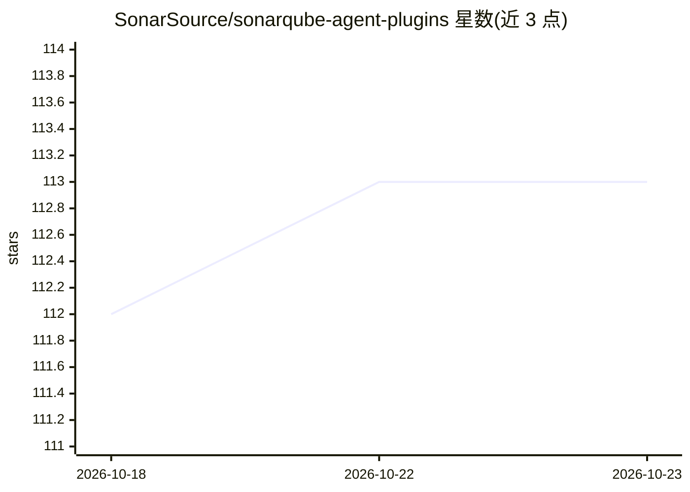

# SonarSource/sonarqube-agent-plugins

⭐ 113 · JavaScript · NOASSERTION · 推送 2026-10-22 · [GitHub](https://github.com/SonarSource/sonarqube-agent-plugins) · 组织维护

**让 AI 编码代理接入 SonarQube 代码质量检查的插件集**

SonarSource 官方发布的多平台代理插件仓库，覆盖 Claude Code、GitHub Copilot CLI、Cursor、Codex、Antigravity、Factory Droid、Kiro 与 Gemini CLI（legacy）。插件将代理连接到 SonarQube CLI 与 SonarQube MCP Server，提供问题检测、质量门禁、覆盖率、重复度与依赖风险查询等斜杠命令；Claude Code、Copilot、Codex、Antigravity 可安装 secrets 扫描与 Vortex 分析 hook，在代理循环内每次编辑后自动运行分析。前置条件为 SonarQube 账号、SonarQube CLI 与容器运行时。

## 筛选速览

| 维度 | 判定 | 备注 |
|---|---|---|
| AI 角色 | `ai-ecosystem` | LLM/agent 周边工具 |
| 许可风险 | `none` | NOASSERTION |
| 部署形态 | `None` |  |
| 模型依赖 | — | README 未给出锁定关系 |
| 硬件要求 | — | 无带数字的原话,不猜 |
| 安装摩擦 | `low` | 无编译、无系统依赖或容器化 |
| 成熟度 | — | 结构信号不足 |

## 能力要点

- 支持 8 种代理/C 客户端的插件包与接入流程
- 通过 MCP Server 提供问题、质量门禁、覆盖率、依赖风险等查询
- Claude/Copilot/Codex/Antigravity 可装 secrets 扫描与 Vortex 分析 hook
- 提供 sonarqube-reviewer 代理做 PR/diff 综合审查

## 适用场景

- 在代理编码流程中自动检查代码问题与泄露密钥
- 让 AI 代理查询项目的质量门禁与测试覆盖率状态
- 按规则号让代理定位并修复 SonarQube 问题

## 场景标签

`代码审查` · 领域:编码与开发

## 证据(README 行号)

> L5: SonarQube is the AI code quality and security verification platform used by millions of developers to catch bugs, vu
> L11: The Plugin helps agents connect to SonarQube CLI and SonarQube MCP Server for issue detection, checking project met
> L196: On **Claude Code**, **GitHub Copilot CLI**, and **Cursor**, the plugin also ships a **`sonarqube-reviewer`** agent

## 星数曲线

2026-10-18 112 → 2026-10-23 113（+1）

---
*卡片 v1 · prompt 1.4 · 生成 2026-10-23 · 置信度 high · 依据 README sha `9d8822581742` · [字段定义](../../DATASET.md)*
