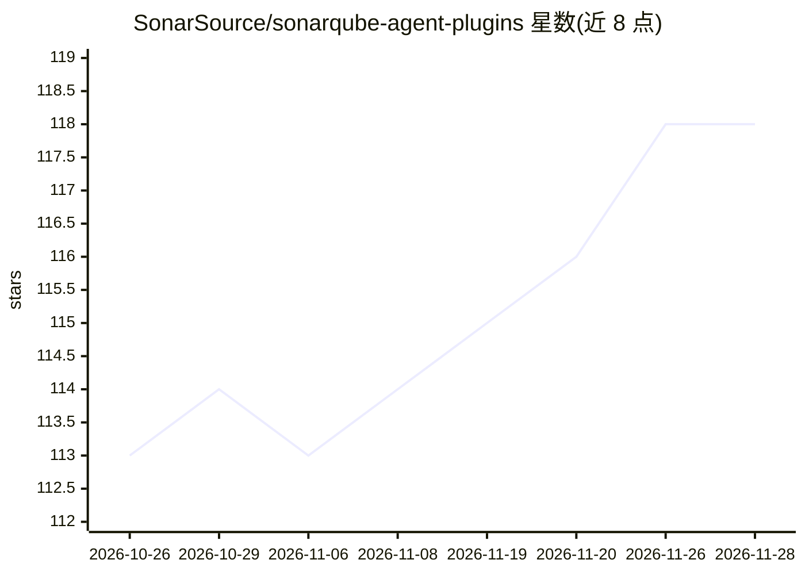

# SonarSource/sonarqube-agent-plugins

⭐ 118 · JavaScript · NOASSERTION · 推送 2026-11-27 · [GitHub](https://github.com/SonarSource/sonarqube-agent-plugins) · 组织维护

**为 AI 编码代理接入 SonarQube 质量检测的插件集合**

SonarSource 官方发布的 SonarQube 代理集成插件，帮助 Claude Code、Copilot CLI、Codex、Cursor、Antigravity、Devin 等编码代理连接 SonarQube CLI 与 MCP Server，用于检测问题、查看测试覆盖率与重复度、获取依赖风险、检查质量门禁，以及在代理循环内运行 secrets 扫描与 Vortex 分析（按账号权益）。每个代理有对应插件包与安装命令，并提供 sonar-integrate、sonar-fix-issue、sonar-quality-gate 等斜杠技能。需要已有 SonarQube 账号（Cloud/Server/Community Build）、SonarQube CLI 与容器运行时。许可证为 SSAL-1.0。

## 筛选速览

| 维度 | 判定 | 备注 |
|---|---|---|
| AI 角色 | `ai-ecosystem` | LLM/agent 周边工具 |
| 许可风险 | `none` | NOASSERTION |
| 部署形态 | `None` |  |
| 模型依赖 | — | README 未给出锁定关系 |
| 硬件要求 | — | 无带数字的原话,不猜 |
| 安装摩擦 | `low` | 无编译、无系统依赖或容器化 |
| 成熟度 | — | 结构信号不足 |

## 能力要点

- 支持 9 种代理客户端的插件安装（Claude Code/Copilot CLI/Codex/Cursor/Antigravity/Factory Droid/Devin/Kiro/OpenCode/Pi）
- 通过 SonarQube MCP Server 提供 issue 检测、覆盖率、重复度、依赖风险等查询
- 在代理循环内安装 secrets 扫描与 Vortex 分析 hooks（部分客户端支持）
- 提供 sonarqube-reviewer 代理将质量门禁、问题、依赖风险等组合为单次 PR/diff 审查（Claude Code/Copilot CLI/Cursor）

## 适用场景

- 让编码代理在提交前检查质量门禁与漏洞
- 在代理会话中用自然语言查询项目的 SonarQube 问题
- 代理每次编辑后自动运行代码分析

## 场景标签

`编码 Agent` `代码审查` `网络安全` · 领域:编码与开发

## 证据(README 行号)

> L11: The Plugin helps agents connect to SonarQube CLI and SonarQube MCP Server for issue detection, checking project met
> L13: How to use: Run `/sonarqube:sonar-integrate` after installation to walk through setup — CLI installation, authentic

## 星数曲线

2026-10-26 113 → 2026-11-28 118（+5）

---
*卡片 v1 · prompt 1.4 · 生成 2026-11-28 · 置信度 high · 依据 README sha `ba79f57b51db` · [字段定义](../../DATASET.md)*
