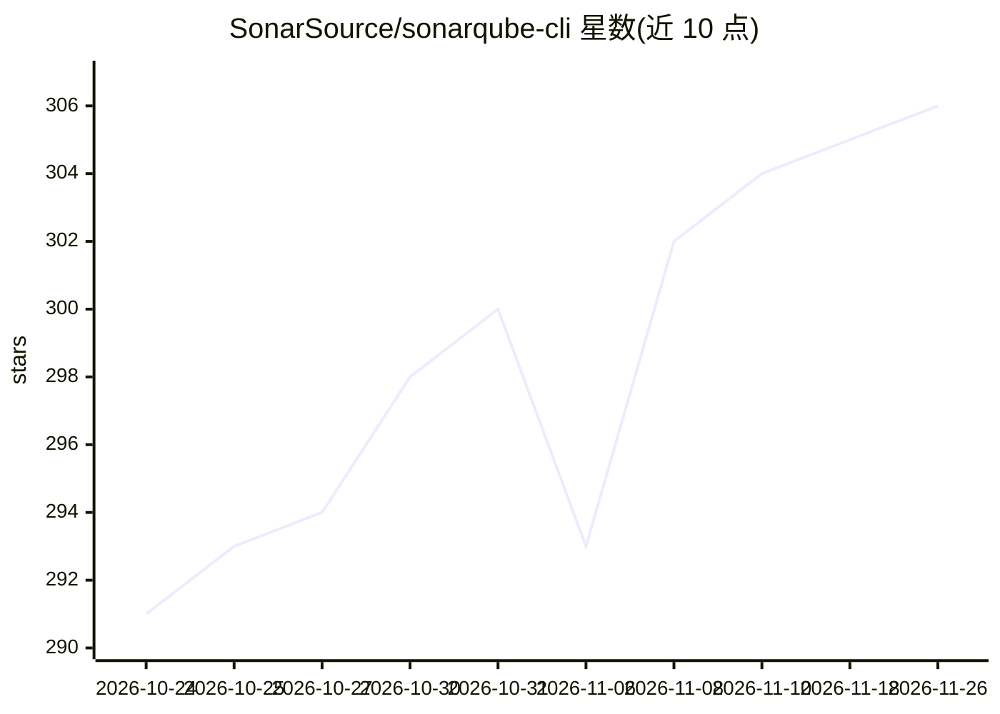

# SonarSource/sonarqube-cli

⭐ 306 · TypeScript · LGPL-3.0 · 推送 2026-11-25 · [GitHub](https://github.com/SonarSource/sonarqube-cli) · [官网](https://cli.sonarqube.com/) · 组织维护

**将 SonarQube 代码质量与密钥扫描接入终端和 AI 编码代理的 CLI**

命令行工具，将 SonarQube Server/Cloud 的静态分析接入本地开发流程：扫描硬编码密钥（命中时退出码 51）、在提交前查看服务端 issue、分析本地未提交变更（限 SonarQube Cloud）、并以 JSON/table/csv/toon 格式输出供脚本使用。集成机制包括为 Claude Code、Copilot CLI 等安装 pre-tool-use 钩子拦截密钥外发、内置 MCP server，并提供面向 LLM 解析的 toon 格式。使用前需具备 SonarQube Cloud 账号或自托管 Server（v2025.1+），本地分析功能仅限 Cloud 版。

## 筛选速览

| 维度 | 判定 | 备注 |
|---|---|---|
| AI 角色 | `ai-enhanced` | 去掉 AI 部分产品仍成立 |
| 许可风险 | `viral` | LGPL-3.0 |
| 部署形态 | `desktop` | 安装包/桌面程序 |
| 模型依赖 | — | README 未给出锁定关系 |
| 硬件要求 | — | 无带数字的原话,不猜 |
| 安装摩擦 | `low` | 无编译、无系统依赖或容器化 |
| 成熟度 | `idea` | |

## 能力要点

- pre-tool-use 钩子拦截硬编码密钥发往 LLM 提供商
- 为 Claude Code / Copilot CLI 安装钩子并提供 MCP server
- JSON 默认输出及面向 LLM 的 toon 格式
- git pre-commit/pre-push 钩子与 CI 环境变量认证

## 适用场景

- 在 AI 编码代理读取代码前拦截硬编码密钥
- 本地快速查看服务端 issue 而不等 CI 结果
- 在脚本与流水线中批量查询项目 issue 并生成报告

## 场景标签

`网络安全` · 领域:学习与行业

## 证据(README 行号)

> L8: SonarQube CLI integrates SonarQube Server and SonarQube Cloud into terminal and AI coding-agent workflows.
> L19: - **🔗 Agent Integration** — Seamless hooks for Claude Code, GitHub Copilot CLI, Codex, Cursor, Antigravity, OpenCod

## 星数曲线

2026-10-24 291 → 2026-11-26 306（+15）

---
*卡片 v1 · prompt 1.4 · 生成 2026-11-25 · 置信度 high · 依据 README sha `5779ebb2c355` · [字段定义](../../DATASET.md)*
