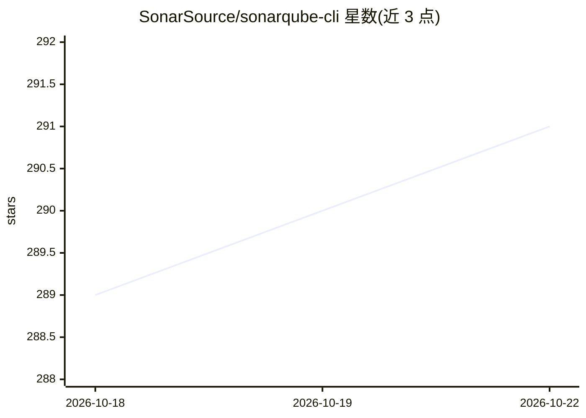

# SonarSource/sonarqube-cli

⭐ 291 · TypeScript · NOASSERTION · 推送 2026-10-21 · [GitHub](https://github.com/SonarSource/sonarqube-cli) · [官网](https://cli.sonarqube.com/) · 组织维护

**SonarQube 官方命令行工具：终端内做代码质量与密钥扫描，并接入 AI 编码代理**

SonarSource 发布的 CLI，面向使用 SonarQube Cloud 或自托管 Server（v25.1+）的开发者。功能包括：检测代码中的硬编码凭证（发现密钥时退出码 51）、对本地未提交改动做服务端问题分析（仅 Cloud）、以 JSON/table/toon/csv 格式列出与管理项目问题，其中 toon 为面向 LLM 的 token 高效输出格式。通过 sonar integrate 命令为 Claude Code、GitHub Copilot CLI、Codex、Cursor 等安装 pre-tool-use 密钥扫描钩子、Agentic Analysis 与 MCP server；也支持 Git pre-commit/pre-push 钩子与 CI/CD 环境变量认证。本地改动分析功能仅限 SonarQube Cloud。

## 筛选速览

| 维度 | 判定 | 备注 |
|---|---|---|
| AI 角色 | `ai-enhanced` | 去掉 AI 部分产品仍成立 |
| 许可风险 | `none` | NOASSERTION |
| 部署形态 | `desktop` | 安装包/桌面程序 |
| 模型依赖 | — | README 未给出锁定关系 |
| 硬件要求 | — | 无带数字的原话,不猜 |
| 安装摩擦 | `low` | 无编译、无系统依赖或容器化 |
| 成熟度 | — | 结构信号不足 |

## 能力要点

- 密钥扫描并阻止硬编码凭证发送至 LLM 提供商（退出码 51）
- sonar integrate 为 Claude Code/Copilot CLI 等安装钩子、Agentic Analysis 与 MCP server
- 面向 LLM 的 toon 输出格式（token 高效的 YAML 风格编码）
- 默认 JSON 输出，支持 jq 管道与脚本化自动化

## 适用场景

- 在终端和 Git 提交前拦截硬编码密钥
- 让 Claude Code/Copilot 等 AI 代理在处理代码前自动扫描密钥并获取质量分析
- 在 CI/CD 中以环境变量认证生成质量报告

## 场景标签

`网络安全` `代码审查` · 领域:编码与开发

## 证据(README 行号)

> L10: - **🔒 Secret Detection** — Scan code for hardcoded credentials and prevent secrets from being sent to LLM providers
> L13: - **🔗 Agent Integration** — Seamless hooks for Claude Code, GitHub Copilot CLI, Codex, Cursor, Antigravity, OpenCod
> L35: 1. **🤖 Agentic Use** — Built-in support for AI coding agents (Claude Code, GitHub Copilot CLI, Codex, Cursor, Antig

## 星数曲线

2026-10-18 289 → 2026-10-22 291（+2）

---
*卡片 v1 · prompt 1.4 · 生成 2026-10-22 · 置信度 high · 依据 README sha `9b8062d50118` · [字段定义](../../DATASET.md)*
