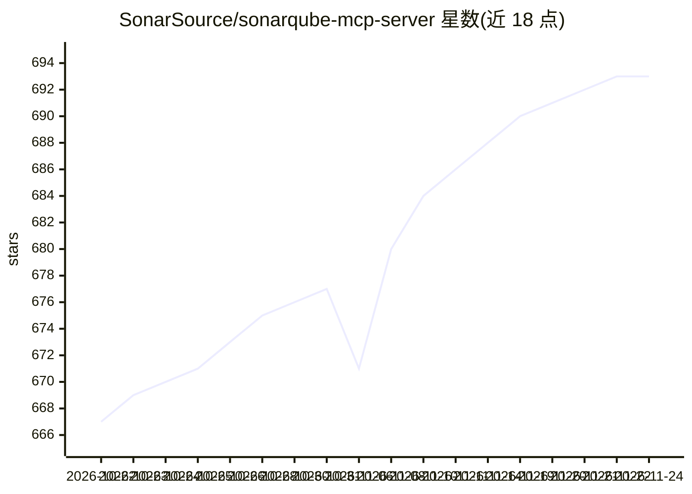

# SonarSource/sonarqube-mcp-server

⭐ 693 · Java · NOASSERTION · 推送 2026-11-21 · [GitHub](https://github.com/SonarSource/sonarqube-mcp-server) · [官网](https://www.sonarsource.com/products/sonarqube/mcp-server/) · 组织维护

**给 AI agent 接入 SonarQube 代码质量与安全数据的 MCP 服务器**

SonarSource 官方的 Model Context Protocol 服务器，将 SonarQube Server 与 SonarQube Cloud 的代码质量与安全能力接入各类 AI agent 客户端，并支持在 agent 上下文中直接分析代码片段。提供交互式配置生成器，通过官方容器镜像分发，为 Antigravity、Claude Code、Codex CLI、Cursor、Gemini CLI、GitHub Copilot、Kiro、VS Code、Windsurf、Zed 等客户端给出各自的一键或手动安装路径。要求提供 SonarQube User token，需配合已部署的 SonarQube Server 或 Cloud 使用，不可独立运行。

## 筛选速览

| 维度 | 判定 | 备注 |
|---|---|---|
| AI 角色 | `ai-ecosystem` | LLM/agent 周边工具 |
| 许可风险 | `none` | NOASSERTION |
| 部署形态 | `desktop` | 安装包/桌面程序 |
| 模型依赖 | — | README 未给出锁定关系 |
| 硬件要求 | — | 无带数字的原话,不猜 |
| 安装摩擦 | `low` | 无编译、无系统依赖或容器化 |
| 成熟度 | — | 结构信号不足 |

## 能力要点

- 官方 MCP 服务器，接入 SonarQube Server/Cloud 的代码质量与安全数据
- 支持在 agent 上下文中直接分析代码片段
- 提供交互式配置生成器与容器镜像（支持版本固定与对齐 SonarQube Server 版本）
- 覆盖 10 种 AI agent 客户端的安装配置说明

## 适用场景

- 在 AI 编程助手中查询代码质量与安全扫描结果
- 让 coding agent 在 CI/CD 中调用 SonarQube 分析能力
- 在 IDE 的 agent 环境内做代码片段质量分析

## 场景标签

`代码审查` · 领域:编码与开发

## 证据(README 行号)

> L8: The SonarQube MCP Server is a Model Context Protocol (MCP) server that enables seamless integration with SonarQube S
> L33: If you prefer to configure things yourself, the simplest method is to use our container image at sonarsource/sonarq
> L193: GitHub Copilot coding agent can leverage the SonarQube MCP server directly in your CI/CD.

## 星数曲线

2026-10-22 667 → 2026-11-24 693（+26）

---
*卡片 v1 · prompt 1.4 · 生成 2026-11-24 · 置信度 mid · 依据 README sha `98608ff0e105` · [字段定义](../../DATASET.md)*
