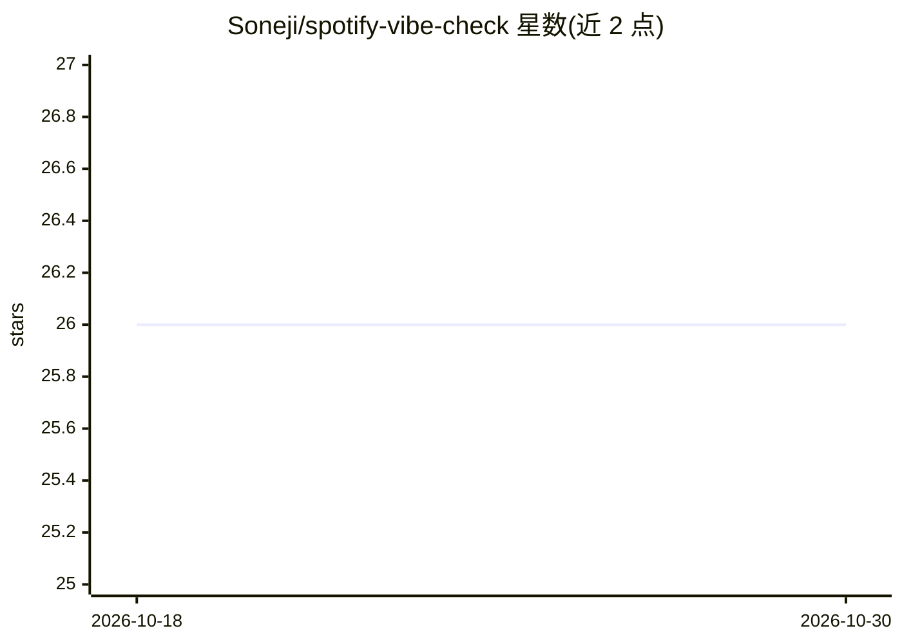

# Soneji/spotify-vibe-check

⭐ 26 · JavaScript · GPL-3.0 · 推送 2026-10-26 · [GitHub](https://github.com/Soneji/spotify-vibe-check) · [官网](https://spotify.soneji.xyz) · 个人维护

**分析 Spotify 播放列表“氛围”的 Web 应用（因 CORS 暂不可用）**

基于 Node.js/npm 的 Web 应用：通过 Spotify API 授权（Client ID/Secret + 回调 URI）读取用户播放列表并进行分析。部署方式为 git clone 源码、npm install 安装依赖、配置 .env、npm run test 启动本地服务器（localhost:8888），可选以 pm2 在服务器上运行。仓库描述声明当前因 CORS 问题处于不可用状态。使用需自行在 Spotify 开发者后台创建应用并选择非商业用途。

## 筛选速览

| 维度 | 判定 | 备注 |
|---|---|---|
| AI 角色 | `ai-native` | 本体是模型或模型工具 |
| 许可风险 | `viral` | GPL-3.0 |
| 部署形态 | `library` | 以包/库形式分发 |
| 模型依赖 | — | README 未给出锁定关系 |
| 硬件要求 | — | 无带数字的原话,不猜 |
| 安装摩擦 | `low` | 无编译、无系统依赖或容器化 |
| 成熟度 | — | 结构信号不足 |

## 能力要点

- 通过 Spotify API 读取用户播放列表
- 本地测试服务器（npm run test，端口 8888）
- 可选 pm2 服务器部署（npm run dist）

## 适用场景

- 连接 Spotify 账号查看播放列表的分析结果
- 自建服务器托管该播放列表分析应用

## 场景标签

`数据分析` · 领域:效率与自动化

## 证据(README 行号)

> L3: ## This is a cheeky app to vibe check your spotify playlists!
> L21:  - Goto https://developer.spotify.com/dashboard/ and click `CREATE AN APP`

## 星数曲线

2026-10-18 26 → 2026-10-30 26（+0）

---
*卡片 v1 · prompt 1.4 · 生成 2026-10-26 · 置信度 low · 依据 README sha `4ffad28e2480` · [字段定义](../../DATASET.md)*
