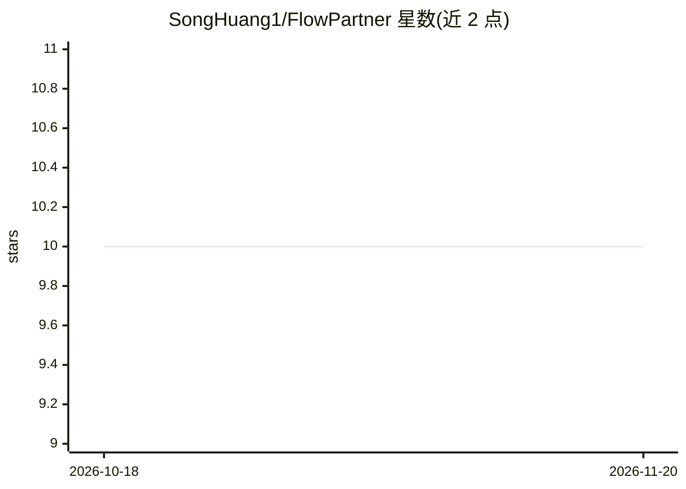

# SongHuang1/FlowPartner

⭐ 10 · Go · MIT · 推送 2026-10-23 · [GitHub](https://github.com/SongHuang1/FlowPartner) · 个人维护 · 中文 README

**面向非技术用户的桌面 AI Agent 客户端，内置安全防护**

FlowPartner 是为无计算机背景用户设计的开源 AI Agent 桌面应用，核心理念是当用户盲目信任 AI 时由软件自身充当安全守门人：危险操作默认拦截、删除命令重定向至可恢复回收站、路径穿越双重校验、API Key 采用 AES-256-GCM + Argon2id 加密存储。架构分三层：Electron+React 前端、Go 通信桥（WebSocket↔gRPC 双向流）、Python Agent 层（ReAct 循环、工具注册、主子 Agent 编排），支持 SSE 流式调用 OpenAI 兼容 API，并内置三重触发的工作快照与恢复机制。

## 筛选速览

| 维度 | 判定 | 备注 |
|---|---|---|
| AI 角色 | `ai-native` | 本体是模型或模型工具 |
| 许可风险 | `permissive` | MIT |
| 部署形态 | `None` |  |
| 模型依赖 | — | README 未给出锁定关系 |
| 硬件要求 | — | 无带数字的原话,不猜 |
| 安装摩擦 | `low` | 无编译、无系统依赖或容器化 |
| 成熟度 | `idea` | |

## 能力要点

- 面向非技术用户的安全设计：危险操作默认拦截、删除重定向至可恢复回收站
- API Key 加密存储（AES-256-GCM + Argon2id）与日志敏感信息过滤
- Go 桥接的 WebSocket↔gRPC 双向流通信管道，全异步非阻塞
- 主子 Agent 编排与三重触发快照机制（文件变化/周期/锁屏）

## 适用场景

- 让不熟悉电脑的家人安全地使用 AI Agent 操作文件
- 需要加密保管 API Key 并限制危险命令的桌面 Agent 环境
- 在 Agent 执行任务时保留快照以便随时恢复工作状态

## 场景标签

`AI 助手` · 领域:对话与助手

## 证据(README 行号)

> L5: FlowPartner is an AI agent desktop app built for non-technical users. People who don't have a computer background te
> L31: - **WebSocket + gRPC bidirectional streaming**: Frontend WebSocket ↔ Go bridge ↔ gRPC bidirectional stream ↔ Python
> L45: - **Main-sub Agent architecture**: Main agent dispatches sub-agents via `agent__<name>` tools, with depth limits an

## 星数曲线

2026-10-18 10 → 2026-11-20 10（+0）

---
*卡片 v1 · prompt 1.4 · 生成 2026-11-20 · 置信度 high · 依据 README sha `94438ebe3cd5` · [字段定义](../../DATASET.md)*
