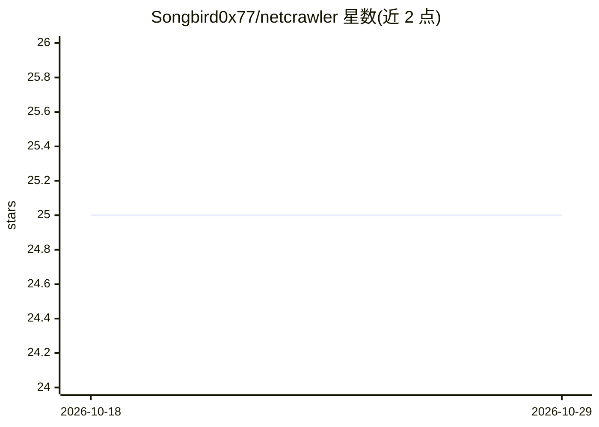

# Songbird0x77/netcrawler

⭐ 25 · Python · MIT · 推送 2026-05-17 · [GitHub](https://github.com/Songbird0x77/netcrawler) · 个人维护

**本地 LLM 驱动的侦察与漏洞扫描 agent，输出结构化报告**

用 Python 编写的 AI 驱动侦察与漏洞扫描代理，由本地 Ollama LLM 提供推理：对目标（IP/域名/URL）归一化后，LLM 循环决定下一步运行哪个侦察工具（subfinder/nmap/nuclei 等），解读原始输出为人类可读发现，最多迭代 12 轮后生成 Markdown 与 JSON 双格式报告。工具模块可通过定义 run 函数并注册 TOOL_MAP 扩展。仅限授权渗透测试场景使用。

## 筛选速览

| 维度 | 判定 | 备注 |
|---|---|---|
| AI 角色 | `ai-native` | 本体是模型或模型工具 |
| 许可风险 | `permissive` | MIT |
| 部署形态 | `library` | 以包/库形式分发 |
| 模型依赖 | local-ok | 支持本地模型 |
| 硬件要求 | — | 无带数字的原话,不猜 |
| 安装摩擦 | `low` | 无编译、无系统依赖或容器化 |
| 成熟度 | — | 结构信号不足 |

## 能力要点

- Ollama 本地 LLM 决策工具调度与输出解读的扫描循环
- 生成 Markdown + JSON 双格式报告，JSON 可导入其他工具
- 通过注册 TOOL_MAP 与系统提示描述扩展自定义扫描模块
- 扫描循环最多 12 轮迭代

## 适用场景

- 对授权目标自动化执行侦察与漏洞扫描并得到解读报告
- 渗透测试前收集子域名、端口与漏洞信息
- 扩展自定义扫描模块供 LLM 调用

## 场景标签

`网络安全` · 领域:学习与行业

## 证据(README 行号)

> L12: An AI-driven reconnaissance and vulnerability scanning agent powered by a local Ollama LLM. The agent reasons about
> L60: 2. **Ollama reasoning** — LLM receives current state, decides next tool

## 星数曲线

2026-10-18 25 → 2026-10-29 25（+0）

---
*卡片 v1 · prompt 1.4 · 生成 2026-10-27 · 置信度 high · 依据 README sha `723dfb92f233` · [字段定义](../../DATASET.md)*
