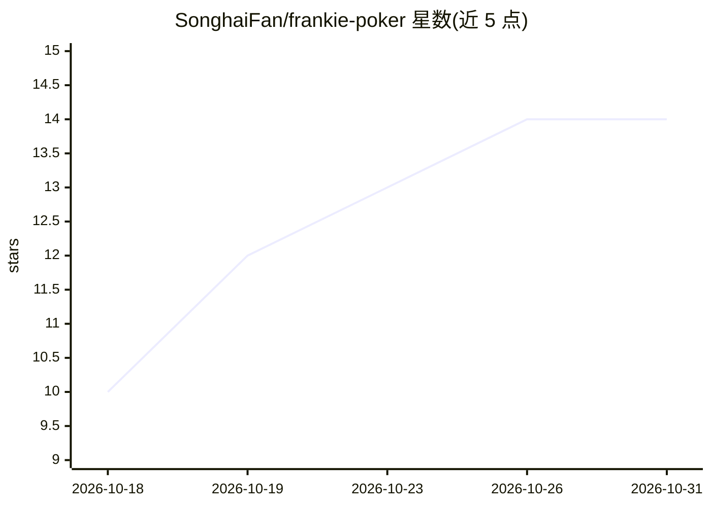

# SonghaiFan/frankie-poker

⭐ 14 · TypeScript · MIT · 推送 2026-10-16 · [GitHub](https://github.com/SonghaiFan/frankie-poker) · [官网](https://songhaifan.github.io/frankie-poker/) · 个人维护 · 中文 README

**与 LLM 对打德州扑克的开源网页游乐场**

开源 No-Limit Texas Hold'em 浏览器应用：用户与语言模型对局，可自选对手模型、编辑其系统提示与打法风格，并在翻前/翻牌/转牌/河牌四条街的样例局面预览模型收到的请求内容。模型调用经 OpenRouter 计费（也可在浏览器填自己的 key，密钥不存服务器）；支持 OpenAI 兼容模式接入自定义 provider。提供无 API key 的本地练习模式（规则型对手）。README 声明这是实验性游乐场，不是 GTO 求解器或受控基准。技术栈为 React/Vite，需 Node.js 22+。

## 筛选速览

| 维度 | 判定 | 备注 |
|---|---|---|
| AI 角色 | `ai-native` | 本体是模型或模型工具 |
| 许可风险 | `permissive` | MIT |
| 部署形态 | `library` | 以包/库形式分发 |
| 模型依赖 | locked-api |  |
| 硬件要求 | — | 无带数字的原话,不猜 |
| 安装摩擦 | `low` | 无编译、无系统依赖或容器化 |
| 成熟度 | `idea` | |

## 能力要点

- 对局对手覆盖 JEV、Gemini、Claude、GPT、Grok、DeepSeek、Kimi（经 OpenRouter）
- 逐街预览模型实际收到的提示、变量值与原始请求
- 通过 plugins/variables.json 与注册插件扩展派生扑克变量
- 自带脚本化模型对模型锦标赛 harness（npm run tournament）

## 适用场景

- 和不同 LLM 打德州扑克并观察其决策
- 编写和调试各对手的策略提示词
- 用模型对模型锦标赛脚本观察不同模型/策略对局
- 无 API key 的本地练习模式熟悉界面与牌局流程

## 场景标签

`提示工程` · 领域:Agent 开发

## 证据(README 行号)

> L5: An open-source No-Limit Texas Hold'em playground for people who want to play against AI and experiment with how it m
> L23: - Play against JEV, Gemini, Claude, GPT, Grok, DeepSeek, and Kimi through OpenRouter. Available models depend on th

## 星数曲线

2026-10-18 10 → 2026-10-31 14（+4）

---
*卡片 v1 · prompt 1.4 · 生成 2026-10-31 · 置信度 mid · 依据 README sha `606769bd72fa` · [字段定义](../../DATASET.md)*
