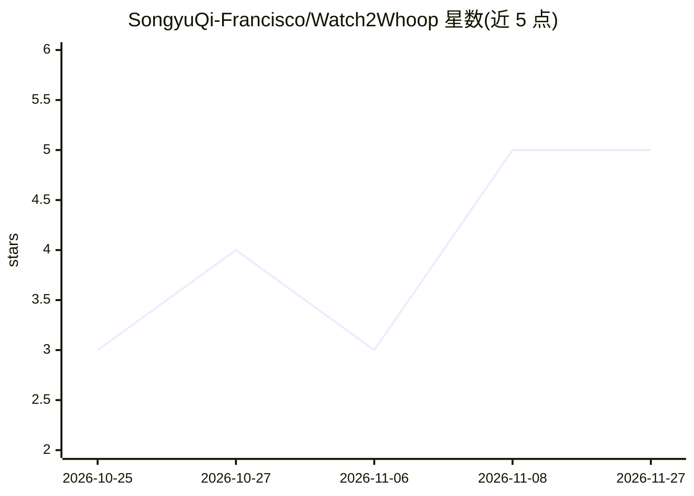

# SongyuQi-Francisco/Watch2Whoop

⭐ 5 · Python · AGPL-3.0 · 推送 2026-11-26 · [GitHub](https://github.com/SongyuQi-Francisco/Watch2Whoop) · 个人维护 · 中文 README

**自托管的 Apple Watch 健康分析服务器，向任意 AI 开放 MCP 数据层**

读取 Apple Watch/HealthKit 的心率、HRV、睡眠分期、血氧等原始数据，在自有服务器上计算恢复度、压力负荷、睡眠需求与债务、身体年龄等指标，公式基于公开研究文献且参数公开。核心定位是「给 AI 的数据层」：提供远程与 stdio MCP 服务器、100+ 读写工具、长期记忆与教练 prompts，AI 模型可替换而数据留在本地；无 AI 也可通过 Web/ iOS 应用查看分数。支持多用户家庭共享、中英文界面，状态为 alpha，非医疗设备。

## 筛选速览

| 维度 | 判定 | 备注 |
|---|---|---|
| AI 角色 | `ai-enhanced` | 去掉 AI 部分产品仍成立 |
| 许可风险 | `viral` | AGPL-3.0 |
| 部署形态 | `None` |  |
| 模型依赖 | local-ok | 支持本地模型 |
| 硬件要求 | — | 无带数字的原话,不猜 |
| 安装摩擦 | `low` | 无编译、无系统依赖或容器化 |
| 成熟度 | `idea` | |

## 能力要点

- 基于公开文献公式计算 WHOOP 风格的恢复度/压力/睡眠分数，参数文档化
- 远程 MCP（Streamable HTTP）与 stdio MCP 服务器，100+ 按用户授权并审计的工具
- 内建聊天支持 Anthropic/OpenAI/Gemini 及任意 OpenAI 兼容端点，密钥按用户加密
- 自托管多用户，支持选择共享的家庭/朋友圈，评分代码拆为独立 Apache-2.0 库

## 适用场景

- 用已有的 Apple Watch 获得恢复度/训练负荷/睡眠分析，不买订阅手环
- 让 Claude、ChatGPT 等助手通过 MCP 读取并记录我的健康数据
- 家庭共用一台服务器，每人一个账号管理自己的健康记录

## 场景标签

`AI 助手` · 领域:对话与助手

## 证据(README 行号)

> L32: - **WHOOP-style numbers from raw watch data** — recovery, strain, sleep need and debt, stress, body age, each again
> L76: Watch2Whoop is a **data layer for your AI**, not another chatbot. The AI is swappable; the data stays.
> L78: - **Remote MCP** at `/mcp` (Streamable HTTP, a per-user AI token) for Claude, ChatGPT / Codex, Gemini / Antigravity

## 星数曲线

2026-10-25 3 → 2026-11-27 5（+2）

---
*卡片 v1 · prompt 1.4 · 生成 2026-11-21 · 置信度 high · 依据 README sha `7f583118c0b3` · [字段定义](../../DATASET.md)*
