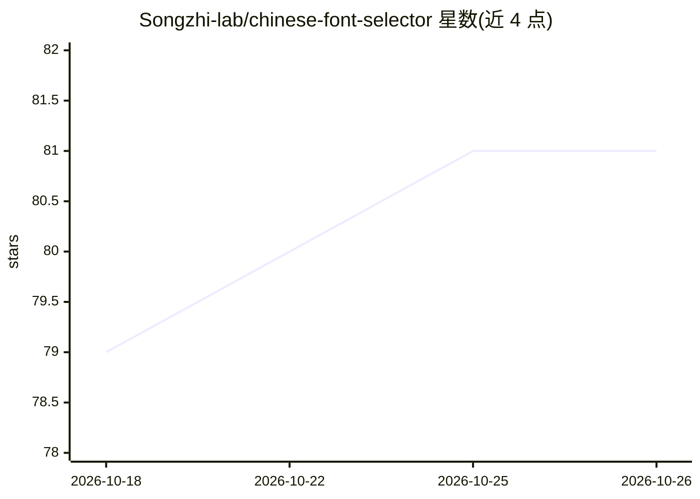

# Songzhi-lab/chinese-font-selector

⭐ 81 · MIT · 推送 2026-08-18 · [GitHub](https://github.com/Songzhi-lab/chinese-font-selector) · 个人维护 · 中文 README

**给 AI Agent 的中文字体选配知识包：授权分级+选字矩阵+混排规则**

一个符合 Agent Skills 规范的知识型技能包，由 SKILL.md 决策框架与两个参考文档构成：可商用中文字体库按授权安全分为 T0/T1/T2 三级（思源黑体、阿里巴巴普惠体、微软雅黑等归入不同等级），并提供五大场景×气质选字矩阵、中英混排配对、字号阶梯、标点避头尾等排版规则。AI 在中文设计任务中触发该 skill 后，按固定模板输出标题/正文/辅助三层字体方案。可通过 npx skills CLI 或手动复制安装，兼容 Kimi、Claude Code、Cursor、Codex 等工具。文档声明不构成法律意见，商用前需自行核实授权状态。

## 筛选速览

| 维度 | 判定 | 备注 |
|---|---|---|
| AI 角色 | `ai-knowledge` | 知识聚合/清单类 |
| 许可风险 | `permissive` | MIT |
| 部署形态 | `library` | 以包/库形式分发 |
| 模型依赖 | — | README 未给出锁定关系 |
| 硬件要求 | — | 无带数字的原话,不猜 |
| 安装摩擦 | `low` | 无编译、无系统依赖或容器化 |
| 成熟度 | — | 结构信号不足 |

## 能力要点

- 授权安全三级分类（T0 开源/T1 厂商免费商用/T2 慎用）
- 五大场景×气质选字矩阵与中英混排配对规则
- 覆盖标点避头尾、字号阶梯、行距行长等排版细则
- 以 SKILL.md + references 结构组织，Agent 可直接执行

## 适用场景

- 做小红书卡片、产品册、海报等中文设计时让 AI 选出可商用字体
- 中英混排场景下避免中文内置拉丁字形的廉价渲染
- 网页中文排版时规避字体全量加载导致的性能问题

## 场景标签

 · 领域:设计/字体排印知识

## 证据(README 行号)

> L5: > 一个给 AI Agent 用的中文字体专业知识包：让 AI 在做中文设计时，**选出合规、好看、能落地的字体**，而不是甩给你一堆 Inter。
> L18: 这个 skill 把「哪些中文字体能免费商用、什么场景用什么字、中英怎么搭、排版怎么排」固化成 AI 可直接执行的知识库。
> L26: ├── SKILL.md                      # 决策框架：授权先行 → 场景×气质 → 混排 → 交付

## 星数曲线

2026-10-18 79 → 2026-10-26 81（+2）

---
*卡片 v1 · prompt 1.4 · 生成 2026-10-24 · 置信度 high · 依据 README sha `1e4d83596845` · [字段定义](../../DATASET.md)*
