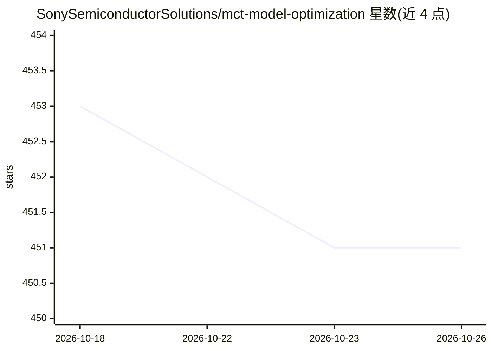

# SonySemiconductorSolutions/mct-model-optimization

⭐ 451 · Python · Apache-2.0 · 推送 2026-10-06 · [GitHub](https://github.com/SonySemiconductorSolutions/mct-model-optimization) · [官网](https://sonysemiconductorsolutions.github.io/mct-model-optimization/) · 组织维护

**神经网络模型量化压缩工具包：面向受限硬件部署优化模型**

索尼半导体解决方案维护的 Python 库，对预训练浮点模型（PyTorch/Keras）执行训练后量化（PTQ）、梯度式 GPTQ/EPTQ、量化感知训练（QAT）、混合精度搜索、结构化剪枝与数据无关量化（基于 BN 统计生成合成数据）。通过 TPC（Target Platform Capabilities）描述目标硬件约束进行硬件感知优化，支持 IMX500 Converter 配套测试。提供 TensorBoard 可视化与 XQuant 量化误差分析报告。用户需自备预训练浮点模型。

## 筛选速览

| 维度 | 判定 | 备注 |
|---|---|---|
| AI 角色 | `ai-ecosystem` | LLM/agent 周边工具 |
| 许可风险 | `permissive` | Apache-2.0 |
| 部署形态 | `library` | 以包/库形式分发 |
| 模型依赖 | — | README 未给出锁定关系 |
| 硬件要求 | — | 无带数字的原话,不猜 |
| 安装摩擦 | `low` | 无编译、无系统依赖或容器化 |
| 成熟度 | — | 结构信号不足 |

## 能力要点

- PTQ/GPTQ(QAT) 三种量化流程，PyTorch 与 Keras 双 API
- TPC 硬件感知优化，针对目标硬件约束量化
- 数据无关量化：基于 BN 层统计生成合成图像
- 结构化剪枝、混合精度搜索与 XQuant 误差分析

## 适用场景

- 把浮点模型压到 8 位以下以部署到边缘硬件
- 在缺少真实数据时用数据生成做训练后量化
- 定位量化后精度损失来源并获得改进建议

## 场景标签

`模型量化` · 领域:训练与推理

## 证据(README 行号)

> L13: Pip install the model compression toolkit package in a Python>=3.10 environment with PyTorch>=2.3 or Tensorflow>=2.
> L35: For each flow, **Quantization core** utilizes various algorithms and hyper-parameters for optimal hardware-aware qu
> L58: 🎯 **TPC (Target Platform Capabilities)**. Describes the target hardware’s constrains, for which the model optimizat

## 星数曲线

2026-10-18 453 → 2026-10-26 451（-2）

---
*卡片 v1 · prompt 1.4 · 生成 2026-10-22 · 置信度 high · 依据 README sha `9b8a37b8ab28` · [字段定义](../../DATASET.md)*
