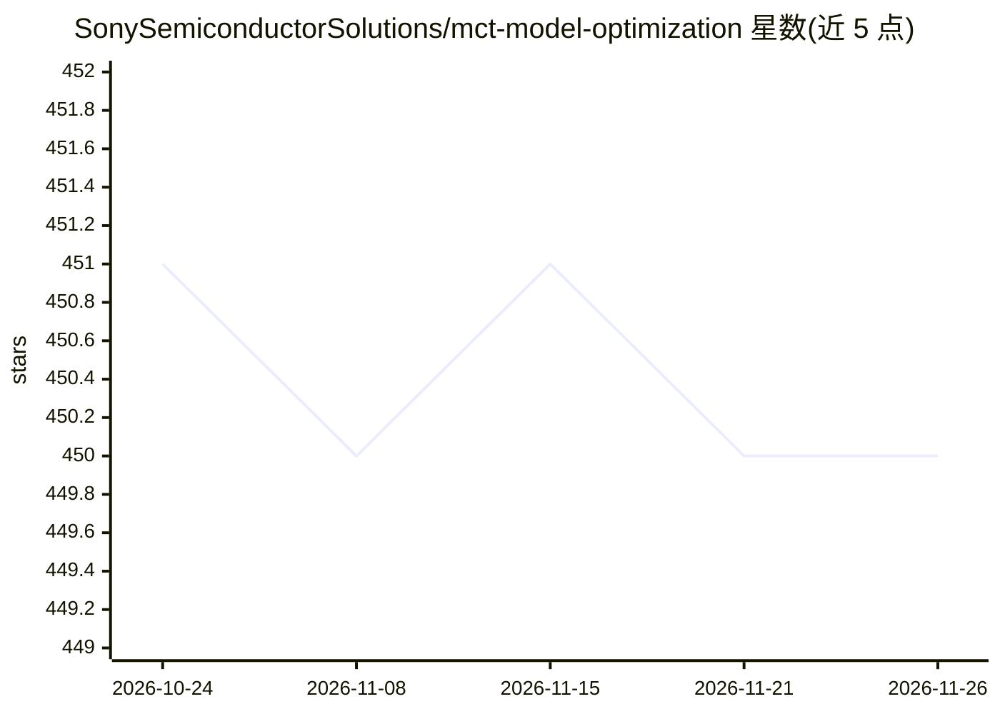

# SonySemiconductorSolutions/mct-model-optimization

⭐ 450 · Python · Apache-2.0 · 推送 2026-11-24 · [GitHub](https://github.com/SonySemiconductorSolutions/mct-model-optimization) · [官网](https://sonysemiconductorsolutions.github.io/mct-model-optimization/) · 组织维护

**面向边缘硬件的神经网络量化压缩工具库**

Sony 半导体团队开源的模型压缩工具包，在算力与存储受限的硬件上优化神经网络以供边缘部署。提供 PTQ、GPTQ、QAT 三种量化流程，配合混合精度搜索、图优化、结构化剪枝、无数据量化（Data Generation）、网络编辑器与 TensorBoard 可视化/XQuant 调试报告等能力。通过 TPC（Target Platform Capabilities）描述目标硬件约束实现硬件感知量化。需用户提供 PyTorch/Keras 预训练浮点模型作为输入，支持将 32-bit 浮点模型量化为 8-bit（或更低）定点模型。

## 筛选速览

| 维度 | 判定 | 备注 |
|---|---|---|
| AI 角色 | `ai-ecosystem` | LLM/agent 周边工具 |
| 许可风险 | `permissive` | Apache-2.0 |
| 部署形态 | `library` | 以包/库形式分发 |
| 模型依赖 | — | README 未给出锁定关系 |
| 硬件要求 | — | 无带数字的原话,不猜 |
| 安装摩擦 | `low` | 无编译、无系统依赖或容器化 |
| 成熟度 | — | 结构信号不足 |

## 能力要点

- PTQ/GPTQ/QAT 三种量化流程，附 API 与教程笔记本
- TPC 硬件感知优化，可描述目标硬件约束
- 结构化剪枝与无数据量化（基于 BN 层统计生成合成图像）
- XQuant 可解释量化报告与逐层错误排查工具

## 适用场景

- 将训练好的模型量化后部署到边缘设备
- 对量化后精度下降的模型做逐层错误定位与调优
- 没有训练数据时基于模型统计做无数据量化

## 场景标签

`模型量化` · 领域:训练与推理

## 证据(README 行号)

> L13: Pip install the model compression toolkit package in a Python>=3.10 environment with PyTorch>=2.3 or Tensorflow>=2.
> L44: MCT offers a range of powerful features to optimize models for efficient edge deployment. These supported features 
> L58: 🎯 **TPC (Target Platform Capabilities)**. Describes the target hardware’s constrains, for which the model optimizat

## 星数曲线

2026-10-24 451 → 2026-11-26 450（-1）

---
*卡片 v1 · prompt 1.4 · 生成 2026-11-25 · 置信度 high · 依据 README sha `01b1ee5dac8c` · [字段定义](../../DATASET.md)*
