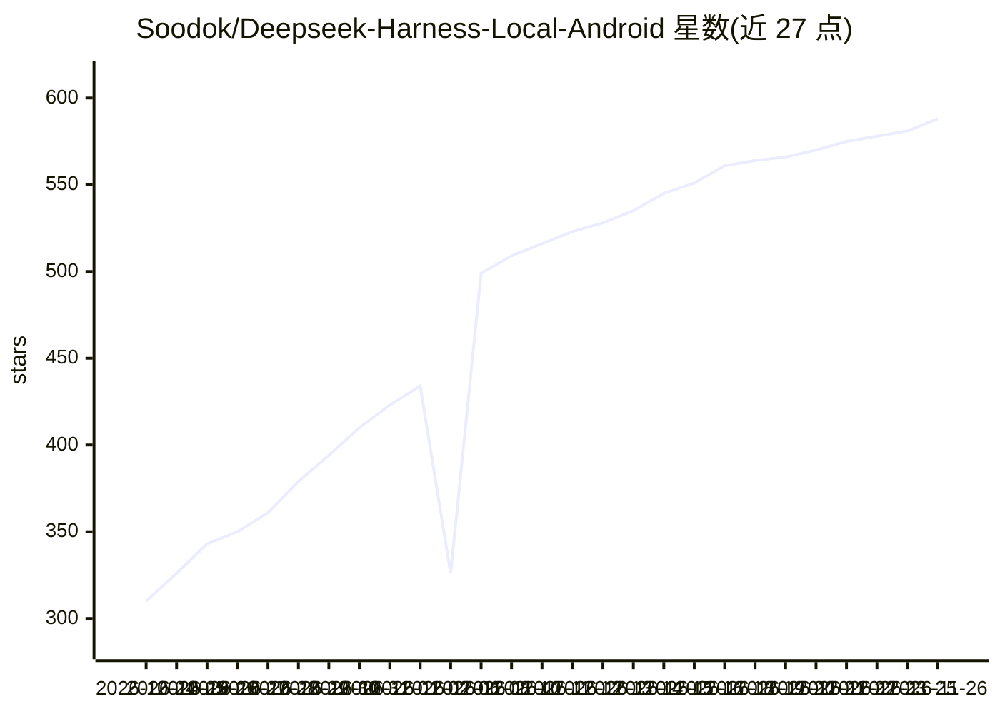

# Soodok/Deepseek-Harness-Local-Android

⭐ 588 · Kotlin · MIT · 推送 2026-11-25 · [GitHub](https://github.com/Soodok/Deepseek-Harness-Local-Android) · 个人维护 · 中文 README

**在 Android 上免 Root 本地运行 DeepSeek Agent 的运行时**

DSH Mobile 将 DeepSeek Harness AI agent 以 Android 原生（bionic）方式打进 APK，免 Root 免 Termux：内置 Node.js 运行时直接 execve 启动，可选加装自研免 root Linux 容器（seccomp+SIGSYS，Alpine/Ubuntu 双 rootfs）支持 glibc 程序与 apt/apk。扩展中心提供 57 个条目、20 套工具链（clang/JDK17/gradle/rust/go 等）支持手机端编译；通过 176 条 HTTP 路由、42 条自描述目录项、21 个能力开关把 Android 设备能力接入 Agent，支持普通/Shizuku/Root 三档身份。

## 筛选速览

| 维度 | 判定 | 备注 |
|---|---|---|
| AI 角色 | `ai-ecosystem` | LLM/agent 周边工具 |
| 许可风险 | `permissive` | MIT |
| 部署形态 | `None` |  |
| 模型依赖 | locked-api |  |
| 硬件要求 | — | 无带数字的原话,不猜 |
| 安装摩擦 | `high` | 编译与系统依赖俱全 |
| 成熟度 | — | 结构信号不足 |

## 能力要点

- 原生 bionic Node.js 运行时直接打进 APK，宣称冷启动 2.3 秒
- 自研免 root 用户态容器（seccomp BPF + SIGSYS），Alpine/Ubuntu 双 rootfs
- 20 套手机端工具链（clang/JDK17/gradle/cmake/rustc/go），可在手机编译 APK
- 176 条设备能力路由 + 42 个 MCP 工具自描述目录 + 21 个独立开关

## 适用场景

- 在无 Root 的 Android 手机上本地运行 coding agent
- 在手机上编译 C/C++/Java 项目并起本地服务预览
- 让 Agent 代为操作手机：点击、输入、读通知、控制 WiFi 等

## 场景标签

`编码 Agent` `GUI 自动化` · 领域:效率与自动化

## 证据(README 行号)

> L1: # DSH Mobile · DeepSeek Harness for Android
> L54: 整套 Node.js 运行时被编译成 Android 原生（bionic）二进制，直接打进 APK。**它不需要「搭建」**——没有 rootfs 要铺、没有伪文件系统要挂、没有软件源要初始化。冷启动只剩三件事：解压（仅首启一次）
> L224: **1354 项权限声明**，真机实收 **432 项**。提供 **176 条 HTTP 路由**、**42 条自描述目录项**，配有 **21 个独立能力开关**——每项能力都要用户单独点头，不是一把梭全开。

## 星数曲线

2026-10-24 310 → 2026-11-26 588（+278）

---
*卡片 v1 · prompt 1.4 · 生成 2026-11-25 · 置信度 high · 依据 README sha `0be2312f9a88` · [字段定义](../../DATASET.md)*
