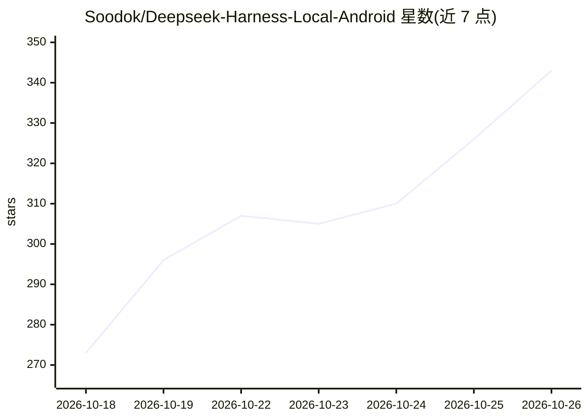

# Soodok/Deepseek-Harness-Local-Android

⭐ 343 · Kotlin · MIT · 推送 2026-10-25 · [GitHub](https://github.com/Soodok/Deepseek-Harness-Local-Android) · 个人维护 · 中文 README

**在 Android 手机本地运行 DeepSeek Harness Agent 的移植 App**

将 DeepSeek 开源的 Agent 框架 dsh（锁定 0.2.1-rc.2）连同 Node.js bionic 运行时完整移植到 Android 应用沙箱，免 Root、免 Termux，装完即用；Agent 逻辑、插件体系与 WebUI 均来自上游，本项目负责 Android 运行层。提供扩展中心（19 项语言/工具环境一键安装）、社区插件安装、无障碍设备操作（21 种动作原语、每步验证闭环）、语音输入、局域网 WebUI 与普通/Shizuku/Root 三级权限。模型通过用户配置的 API 服务访问，非端侧模型；会话、凭证与工作区留在设备本地。

## 筛选速览

| 维度 | 判定 | 备注 |
|---|---|---|
| AI 角色 | `ai-ecosystem` | LLM/agent 周边工具 |
| 许可风险 | `permissive` | MIT |
| 部署形态 | `None` |  |
| 模型依赖 | locked-api |  |
| 硬件要求 | — | 无带数字的原话,不猜 |
| 安装摩擦 | `high` | 编译与系统依赖俱全 |
| 成熟度 | — | 结构信号不足 |

## 能力要点

- 官方 dsh 引擎 + bionic 版 Node.js 运行时直接打进 APK，免 Root 免 Termux
- 扩展中心提供 19 项环境扩展一键安装与卸载，Agent 可自装扩展
- 无障碍设备操作：21 种动作原语，PICK→ACT→VERIFY→RETRY 本地闭环，实测约 1.45 秒/步
- 普通/Shizuku/Root 三级权限模式，默认应用沙箱并配 su 闸门

## 适用场景

- 在手机上运行 dsh Agent 执行文件、命令与项目工作流
- 让 AI 通过无障碍服务操作手机屏幕完成跨应用任务
- 通过同一局域网在电脑上访问手机内运行的原生 WebUI

## 场景标签

`编码 Agent` `GUI 自动化` · 领域:效率与自动化

## 证据(README 行号)

> L25: DSH Mobile 是 DeepSeek Harness（DeepSeek 开源的 Agent 框架）的 **Android 完整移植**。完整的 Node.js Agent 引擎运行在应用沙箱内，监听 `127.0.0.1` 
> L27: **这是**：官方 dsh 引擎（锁定 `0.2.1-rc.2`）+ 自建 Android 运行环境。插件体系、WebUI、工具调用链全部来自上游，本项目负责运行层：bionic 版 Node.js 运行时、前台服务保活、三级权限
> L225: **它是自己实现了一套 Agent 吗？** 不是。Agent 逻辑、插件体系、WebUI 全部来自官方 `@deepseek-ai/dsh`；本项目只做 Android 侧运行环境。这也是它被称作「**移植**」而不是「框架」

## 星数曲线

2026-10-18 273 → 2026-10-26 343（+70）

---
*卡片 v1 · prompt 1.4 · 生成 2026-10-21 · 置信度 high · 依据 README sha `12d5e6689503` · [字段定义](../../DATASET.md)*
