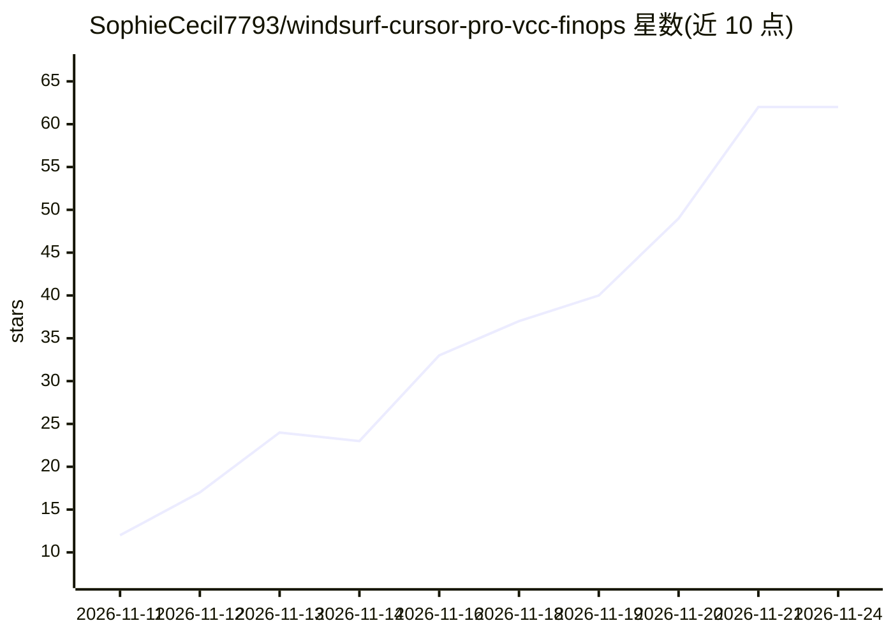

# SophieCecil7793/windsurf-cursor-pro-vcc-finops

⭐ 62 · 推送 2026-11-11 · [GitHub](https://github.com/SophieCecil7793/windsurf-cursor-pro-vcc-finops) · [官网](https://app.coregold.io/signup?invite_code=ADvlj9b) · 个人维护 · 中文 README

**推广 CoreGold 虚拟卡订阅 Windsurf/Cursor 的付费教程页面**

仓库内容为一篇推广 CoreGold 商业虚拟卡（VCC）服务的图文指南：声称用 USDT（TRC20/ERC20）充值后签发欧美商业卡段虚拟卡，用于订阅 Windsurf/Cursor 的 Pro/Business 计划，并给出三步操作流程（充值、开卡、绑卡）。文中列述国内双币卡被拒付的多种风控情形并与 CoreGold 卡对比。仓库不含任何可安装或运行的软件代码，末尾附有推广链接与哈希字符串。

## 筛选速览

| 维度 | 判定 | 备注 |
|---|---|---|
| AI 角色 | `ai-knowledge` | 知识聚合/清单类 |
| 许可风险 | `none` | — |
| 部署形态 | `None` |  |
| 模型依赖 | — | README 未给出锁定关系 |
| 硬件要求 | — | 无带数字的原话,不猜 |
| 安装摩擦 | `low` | 无编译、无系统依赖或容器化 |
| 成熟度 | — | 结构信号不足 |

## 能力要点

- 内容为支付服务推广教程，无软件代码或可安装产物
- 声称支持 USDT（TRC20/ERC20）充值并生成北美英文账单地址的虚拟卡
- 提供三步图文流程：充值、开卡、在 Stripe 结算页绑卡

## 适用场景

- 作为虚拟卡服务商 CoreGold 的营销引流页面
- 了解订阅 Windsurf/Cursor 时绑卡被拒的常见风控叙述

## 场景标签

 · 领域:支付服务营销

## 证据(README 行号)

> L2: ⚡ 2026 实战指南：手把手教你用 CoreGold 商业 VCC 开通 Windsurf / Cursor 满血编程
> L56: 👉 **点击注册并进入 CoreGold 官方发卡后台**

## 星数曲线

2026-11-11 12 → 2026-11-24 62（+50）

---
*卡片 v1 · prompt 1.4 · 生成 2026-11-18 · 置信度 high · 依据 README sha `8ad1d2f1941f` · [字段定义](../../DATASET.md)*
