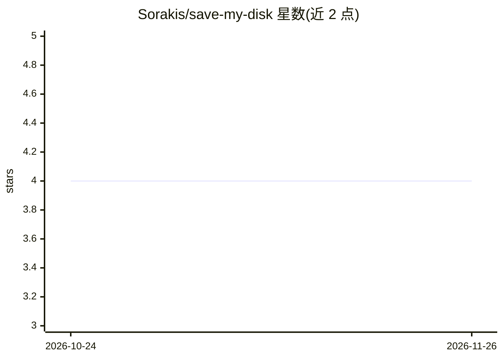

# Sorakis/save-my-disk

⭐ 4 · PowerShell · MIT · 推送 2026-10-31 · [GitHub](https://github.com/Sorakis/save-my-disk) · 个人维护 · 中文 README

**让 AI 编程助手安全做磁盘体检与清理的技能与脚本集**

面向 AI 编程助手（Antigravity、Codex、Claude Code、Cursor 等）与开发者的磁盘诊断与瘦身工具包：PowerShell 脚本执行只读体检，按四级风险矩阵分级候选清理项，清理须经用户显式授权，完成后回访核验空间差值与服务健康。支持多 Agent 协议（SKILL.md/AGENTS.md/CLAUDE.md），也可脱离 AI 在 PowerShell 终端独立运行。当前仅支持 Windows，macOS 在路线图中。

## 筛选速览

| 维度 | 判定 | 备注 |
|---|---|---|
| AI 角色 | `ai-enhanced` | 去掉 AI 部分产品仍成立 |
| 许可风险 | `permissive` | MIT |
| 部署形态 | `None` |  |
| 模型依赖 | — | README 未给出锁定关系 |
| 硬件要求 | — | 无带数字的原话,不猜 |
| 安装摩擦 | `low` | 无编译、无系统依赖或容器化 |
| 成熟度 | — | 结构信号不足 |

## 能力要点

- 四级风险决策矩阵（零风险→开发者缓存→应用残留→红线禁区）
- 双轨执行：Agent 一键脚本须用户授权，GUI 操作输出分步指引
- 支持 SKILL.md/AGENTS.md/CLAUDE.md 多 Agent 协议接入
- 提供纯终端 CLI 模式与零依赖 HTML 战报、TUI 控制台

## 适用场景

- 开发机磁盘告急时让 AI 助手做只读体检并定向清理缓存
- 治理 WSL2/Docker 虚拟磁盘、Hugging Face/Ollama 模型缓存等开发占用
- 清理微信、浏览器缓存同时保护聊天数据库与凭据文件

## 场景标签

 · 领域:系统工具/磁盘管理

## 证据(README 行号)

> L3: > **Universal AI Agent Skill & Runbook for Intelligent, Non-Invasive Disk Optimization.**
> L110: ### 方式二：脱离 AI，人类开发者纯终端独立使用 (CLI Mode)

## 星数曲线

2026-10-24 4 → 2026-11-26 4（+0）

---
*卡片 v1 · prompt 1.4 · 生成 2026-11-21 · 置信度 high · 依据 README sha `93747cf04e09` · [字段定义](../../DATASET.md)*
