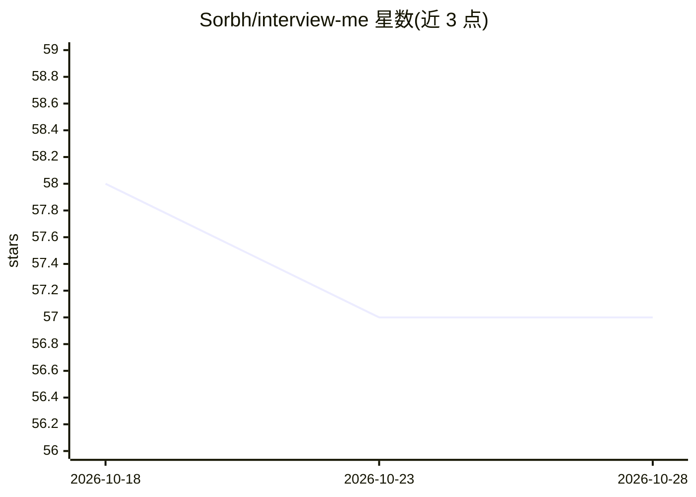

# Sorbh/interview-me

⭐ 57 · MIT · 推送 2026-07-25 · [GitHub](https://github.com/Sorbh/interview-me) · 个人维护

**Claude Code 技能：以架构师式访谈把模糊需求转为规范文档**

运行于 Claude Code 的技能插件：读取需求（本地文件、内联文本、GitHub issue），先判断现有代码是否相关（扫描前询问，无代码则进入 greenfield 模式），随后逐条提问、追问矛盾与边界情况，并在安全缺口处阻断；最终输出含决策日志与实现顺序的 markdown 规范。可选生成图示化规范预览并发布为 claude.ai 分享链接。附带 --verify 漂移检测：重读规范、重扫代码，逐条报告不一致，每条发现附 file:line 或空搜索记录。面向独立开发者与使用 Claude Code 的工程师，MIT 许可。

## 筛选速览

| 维度 | 判定 | 备注 |
|---|---|---|
| AI 角色 | `ai-ecosystem` | LLM/agent 周边工具 |
| 许可风险 | `permissive` | MIT |
| 部署形态 | `None` |  |
| 模型依赖 | locked-api |  |
| 硬件要求 | — | 无带数字的原话,不猜 |
| 安装摩擦 | `low` | 无编译、无系统依赖或容器化 |
| 成熟度 | — | 结构信号不足 |

## 能力要点

- 逐条访谈式提问并对矛盾与安全缺口追问/阻断，产出含决策日志的 markdown 规范
- --verify 漂移检测：对比规范与代码，发现均附 file:line 依据，git diff -M 裁决重命名
- 需求来源支持本地文件、内联文本、GitHub issue（可回贴规范）
- 可选发布图示化规范预览为 claude.ai 私有分享链接

## 适用场景

- 独立开发时把模糊想法访谈成可实施的技术规范
- 规格书写完数月后检测代码与规范的不一致之处
- 从 GitHub issue 直接生成规范并回贴到 issue

## 场景标签

`提示工程` · 领域:Agent 开发

## 证据(README 行号)

> L3: **A Claude Code skill that interviews you like a senior architect before you write code.**
> L5: Claude Code Skill &nbsp; MIT License
> L22: /plugin marketplace add Sorbh/interview-me

## 星数曲线

2026-10-18 58 → 2026-10-28 57（-1）

---
*卡片 v1 · prompt 1.4 · 生成 2026-10-24 · 置信度 high · 依据 README sha `7657c96512bf` · [字段定义](../../DATASET.md)*
