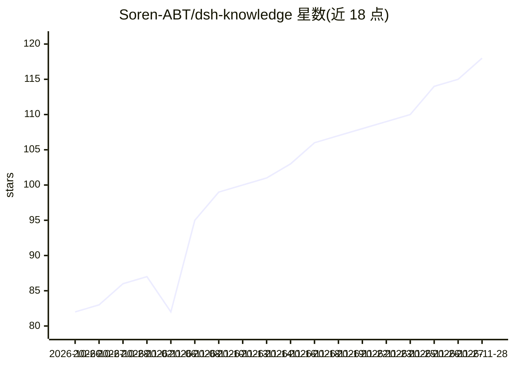

# Soren-ABT/dsh-knowledge

⭐ 118 · TypeScript · AGPL-3.0 · 推送 2026-11-24 · [GitHub](https://github.com/Soren-ABT/dsh-knowledge) · 个人维护 · 中文 README

**给 DSH 提供知识库与 RAG 检索的插件**

作为 DeepSeek Harness（DSH）的可安装 bundle 插件运行，提供知识库（含分组）与文档管理、文本分块、向量化与检索能力。导入 PDF、Word、HTML、Markdown 等格式资料，支持关键词检索、向量检索与混合检索，命中结果带文档标题与分块位置便于核对引用；支持目录绑定定时同步、本地 OCR 与可选 MinerU 结构化解析，并提供 15 个模型可见工具及浏览器管理面板。依赖 Node.js ≥22 与 SQLite，通过 dsh plugin 命令安装。

## 筛选速览

| 维度 | 判定 | 备注 |
|---|---|---|
| AI 角色 | `ai-ecosystem` | LLM/agent 周边工具 |
| 许可风险 | `viral` | AGPL-3.0 |
| 部署形态 | `None` |  |
| 模型依赖 | local-ok | 支持本地模型 |
| 硬件要求 | — | 无带数字的原话,不猜 |
| 安装摩擦 | `low` | 无编译、无系统依赖或容器化 |
| 成熟度 | — | 结构信号不足 |

## 能力要点

- 关键词、向量与混合三种检索模式，命中带引用位置可续读
- 目录绑定磁盘路径，手动或定时同步增删改
- 扫描 PDF 本地 OCR，可选 MinerU 解析表格公式多栏文档
- 15 个模型可见工具（检索、续读、导入、重建索引等）

## 适用场景

- 把项目手册、论文、团队 Wiki 导入后按问题检索原文并核对引用
- 绑定资料目录，定时同步保持知识库更新
- 在面板做召回测试，查看得分与耗时
- 让 Agent 的检索工具限定在指定知识库范围内搜索

## 场景标签

`RAG` `文档问答` · 领域:知识与检索

## 证据(README 行号)

> L15: 一个深度的**知识库系统**，作为 DeepSeek Harness（DSH）的独立、可开源 bundle 插件。提供知识库（含**分组**）与文档管理、文本分块、向量化（OpenAI 兼容 / Ollama / **本地模型**
> L29: |核对模型的引用|每个命中带有文档标题和分块位置。可从命中向前、向后续读；有结构化解析结果时，还可读取对应的原文块。面板的召回测试可查看得分、耗时并复制引用。|
> L70: `knowledge_search` 接受 `baseId` 或 `baseIds`。例如，先用 `knowledge_list_bases` 取得库 ID，再把搜索限制在两个库，同时排除标题含“目录”的文档。

## 星数曲线

2026-10-26 82 → 2026-11-28 118（+36）

---
*卡片 v1 · prompt 1.4 · 生成 2026-11-28 · 置信度 mid · 依据 README sha `3ed454911df8` · [字段定义](../../DATASET.md)*
