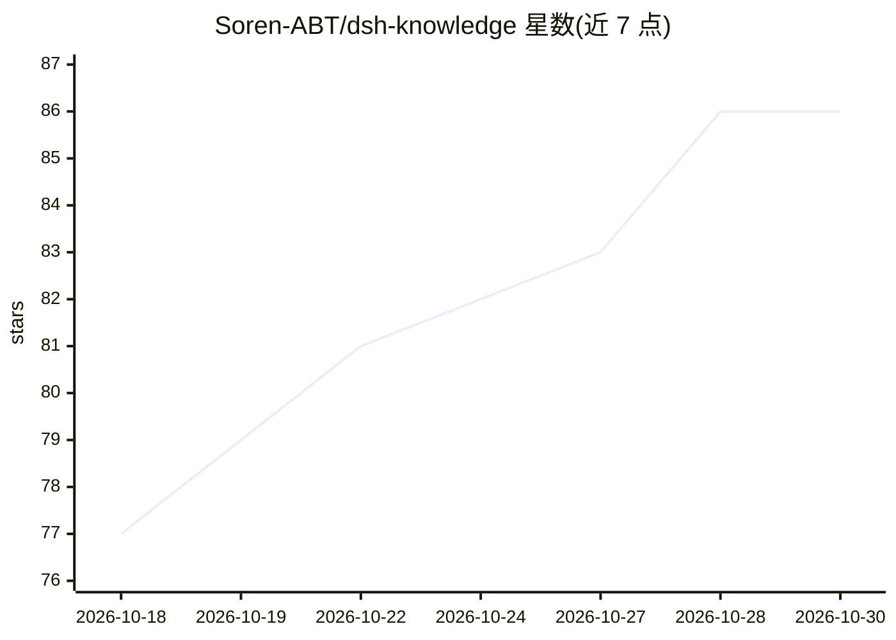

# Soren-ABT/dsh-knowledge

⭐ 86 · TypeScript · AGPL-3.0 · 推送 2026-10-18 · [GitHub](https://github.com/Soren-ABT/dsh-knowledge) · 个人维护 · 中文 README

**DeepSeek Harness 的知识库与 RAG 插件：文档分块、混合检索、本地模型**

作为 DeepSeek Harness（DSH）的开源 bundle 插件运行的知识库系统：支持文件/目录/网页/文本导入与分组管理，标题感知分块，embedding 可选 OpenAI 兼容接口、Ollama、transformers.js 本地模型或纯关键词降级模式；检索融合 SQLite FTS5 BM25 与向量召回（RRF 融合、MMR 去重、可选重排），按命中动态生成可续读的 ContextWindow 证据。本地 OCR 含 PaddleOCR PP-OCRv5 与 Tesseract 回退，向模型暴露 14 个知识库工具，并提供浏览器管理面板。需 Node.js 22+ 与 pnpm 10+，通过 dsh plugin 命令安装，安装期依赖 pnpm 构建许可配置。

## 筛选速览

| 维度 | 判定 | 备注 |
|---|---|---|
| AI 角色 | `ai-ecosystem` | LLM/agent 周边工具 |
| 许可风险 | `viral` | AGPL-3.0 |
| 部署形态 | `library` | 以包/库形式分发 |
| 模型依赖 | local-ok | 支持本地模型 |
| 硬件要求 | — | 无带数字的原话,不猜 |
| 安装摩擦 | `low` | 无编译、无系统依赖或容器化 |
| 成熟度 | — | 结构信号不足 |

## 能力要点

- 混合检索：FTS5 BM25 + 向量召回 + RRF 融合 + MMR 去重 + 可选重排
- 本地 embedding（Qwen3-Embedding-0.6B-ONNX）、本地 rerank、本地 OCR（PaddleOCR/Tesseract）均在独立子进程运行
- 向模型提供 14 个知识库工具，含 ContextWindow 证据与锚点续读
- 零向量配置可用关键词检索；浏览器管理面板支持批量导入、召回测试与模型管理

## 适用场景

- 为 DSH 中的模型挂载本地知识库，回答时自动注入检索证据
- 把本地文档目录变成可重扫、可重建索引的知识库
- 在无远程 API 的环境下用本地 embedding/OCR 跑通 RAG

## 场景标签

`RAG` `OCR` · 领域:知识与检索

## 证据(README 行号)

> L14: 一个深度的**知识库系统**，作为 DeepSeek Harness（DSH）的独立、可开源 bundle 插件。提供知识库（含**分组**）与文档管理、文本分块、向量化（OpenAI 兼容 / Ollama / **本地模型**
> L172: ### 模型工具

## 星数曲线

2026-10-18 77 → 2026-10-30 86（+9）

---
*卡片 v1 · prompt 1.4 · 生成 2026-10-24 · 置信度 mid · 依据 README sha `85c1ae4645fd` · [字段定义](../../DATASET.md)*
