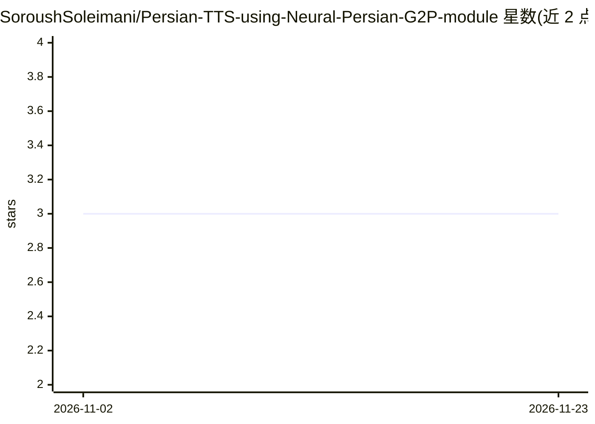

# SoroushSoleimani/Persian-TTS-using-Neural-Persian-G2P-module

⭐ 3 · Jupyter Notebook · MIT · 推送 2026-10-26 · [GitHub](https://github.com/SoroushSoleimani/Persian-TTS-using-Neural-Persian-G2P-module) · 个人维护

**波斯语神经 TTS 框架：G2P 消歧加 VITS 合成语音**

面向波斯语的端到端神经文本转语音框架，采用两阶段解耦流水线：先用波斯语文本归一化器与神经 G2P 音素化模块恢复短元音等隐含语音信息、处理 ZWNJ 与同形异义词消歧，再用 VITS 变分模型与 HiFi-GAN 声码器合成 16 kHz 波形。推理默认加载 Meta MMS 预训练检查点，开箱即用；提供 CLI（单句/批量/交互模式）与 Python API，附六个研究用 Jupyter notebook。推理依赖 Hugging Face 拉取预训练模型，CUDA 可选、CPU 可回退。基于 mrrhbr 的同名仓库扩展。

## 筛选速览

| 维度 | 判定 | 备注 |
|---|---|---|
| AI 角色 | `ai-native` | 本体是模型或模型工具 |
| 许可风险 | `permissive` | MIT |
| 部署形态 | `library` | 以包/库形式分发 |
| 模型依赖 | — | README 未给出锁定关系 |
| 硬件要求 | — | 无带数字的原话,不猜 |
| 安装摩擦 | `medium` | 含编译或系统依赖之一 |
| 成熟度 | — | 结构信号不足 |

## 能力要点

- 两阶段解耦：神经 G2P 消歧 + VITS/HiFi-GAN 波形合成
- 零配置推理：默认使用 Meta MMS 预训练检查点 facebook/mms-tts-fas
- CLI 支持单句、文件批量与交互式合成，另提供 Python API
- 自动 CUDA 检测与 CPU 回退，附六个研究 notebook

## 适用场景

- 把波斯语文本合成为语音文件（WAV）
- 研究波斯语 G2P 音素消歧与声学评估
- 在 Python 应用中集成波斯语 TTS 能力

## 场景标签

`语音合成` · 领域:内容生成

## 证据(README 行号)

> L10: **An end-to-end, high-fidelity neural Text-to-Speech (TTS) framework for the Persian language, combining Grapheme-t
> L22: This repository solves this bottleneck through a **two-stage decoupled neural pipeline**:
> L28: - **Zero-Setup Inference:** Out-of-the-box synthesis powered by Meta MMS pretrained VITS checkpoint (`facebook/mms-

## 星数曲线

2026-11-02 3 → 2026-11-23 3（+0）

---
*卡片 v1 · prompt 1.4 · 生成 2026-11-22 · 置信度 high · 依据 README sha `9beb6509c03b` · [字段定义](../../DATASET.md)*
