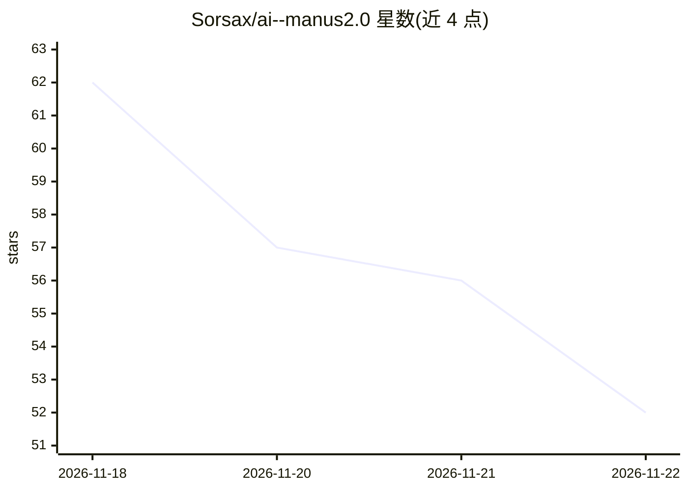

# Sorsax/ai--manus2.0

⭐ 52 · Apache-2.0 · 推送 2026-11-18 · [GitHub](https://github.com/Sorsax/ai--manus2.0) · 个人维护

**面向个人用户的自主 AI Agent：代用户执行代码与浏览器操作**

README 描述 Manus 为一个通用自主 AI Agent，可在沙盒环境中运行代码并控制浏览器：撰写并执行脚本、打开网页、交互元素、执行多步任务。定位为面向家庭、学习与轻量办公场景的个人助手，提供会话间记忆与自动化任务触发设置。README 以功能介绍与使用步骤为主，未给出命令行安装方式、下载链接的具体指向或源码构建说明，安装途径仅见'Download Manus'字样与促销码。

## 筛选速览

| 维度 | 判定 | 备注 |
|---|---|---|
| AI 角色 | `ai-native` | 本体是模型或模型工具 |
| 许可风险 | `permissive` | Apache-2.0 |
| 部署形态 | `None` |  |
| 模型依赖 | — | README 未给出锁定关系 |
| 硬件要求 | — | 无带数字的原话,不猜 |
| 安装摩擦 | `low` | 无编译、无系统依赖或容器化 |
| 成熟度 | — | 结构信号不足 |

## 能力要点

- 自主执行代码完成多步任务
- 控制浏览器进行导航、填表与信息收集
- 后台常驻的个人助手模式，支持任务触发配置
- 跨会话记住工作流模式并复用

## 适用场景

- 整理研究资料并运行小段脚本
- 从多个网页收集数据
- 自动化填写重复表单等日常琐事
- 轻量办公中的信息汇总与小结准备

## 场景标签

`AI 助手` `浏览器自动化` · 领域:效率与自动化

## 证据(README 行号)

> L10: - **Autonomous Code Execution:** Manus AI agent runs code on its own to complete tasks, so you can focus on decisio
> L18: Manus is an autonomous AI agent designed to run code and control a browser on your behalf. Instead of acting like a
> L41: |**Memory (RAM)**|4 GB|8 GB or more for heavy Manus autonomous tasks|

## 星数曲线

2026-11-18 62 → 2026-11-22 52（-10）

---
*卡片 v1 · prompt 1.4 · 生成 2026-11-19 · 置信度 mid · 依据 README sha `ae690c22ca27` · [字段定义](../../DATASET.md)*
