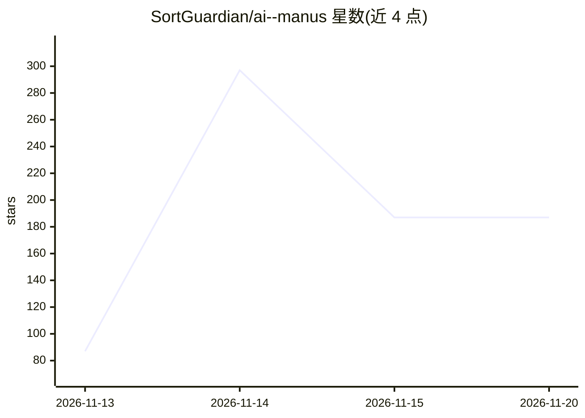

# SortGuardian/ai--manus

⭐ 187 · Apache-2.0 · 推送 2026-11-15 · [GitHub](https://github.com/SortGuardian/ai--manus) · 个人维护

**自主 AI Agent 系统：在沙箱中运行代码并控制浏览器完成任务**

Manus 是一个面向个人用户（学生、远程工作者、轻量办公场景）的自主 AI Agent：用户描述需求后，Agent 自行规划步骤，可编写并执行脚本、打开网页、与页面元素交互、执行多步骤任务。README 描述其定位为家庭、学习与小任务助手，非企业平台。给出系统兼容性要求（双核 CPU、4GB 内存起，推荐 8GB）与上手流程（配置、测试、维护），但未提供具体安装命令、下载渠道细节或模型接入方式。

## 筛选速览

| 维度 | 判定 | 备注 |
|---|---|---|
| AI 角色 | `ai-native` | 本体是模型或模型工具 |
| 许可风险 | `permissive` | Apache-2.0 |
| 部署形态 | `None` |  |
| 模型依赖 | — | README 未给出锁定关系 |
| 硬件要求 | — | 无带数字的原话,不猜 |
| 安装摩擦 | `low` | 无编译、无系统依赖或容器化 |
| 成熟度 | — | 结构信号不足 |

## 能力要点

- 自主代码执行：Agent 自行编写并运行脚本完成任务
- 浏览器控制：导航网页、填写表单、采集信息
- 代码与浏览器动作可在同一任务流中衔接
- 面向家庭、学习与轻量办公的小规模场景设计

## 适用场景

- 让 Agent 代为浏览网页采集信息、填表
- 自动执行重复性脚本与日常小任务
- 学习中整理研究笔记、跑快速计算
- 远程办公时汇总多页面信息准备简报

## 场景标签

`AI 助手` `浏览器自动化` `编码 Agent` · 领域:效率与自动化

## 证据(README 行号)

> L10: - **Autonomous Code Execution:** Manus AI agent runs code on its own to complete tasks, so you can focus on decisio
> L18: Manus is an autonomous AI agent designed to run code and control a browser on your behalf. Instead of acting like a

## 星数曲线

2026-11-13 87 → 2026-11-20 187（+100）

---
*卡片 v1 · prompt 1.4 · 生成 2026-11-17 · 置信度 low · 依据 README sha `a3d88e202bf0` · [字段定义](../../DATASET.md)*
