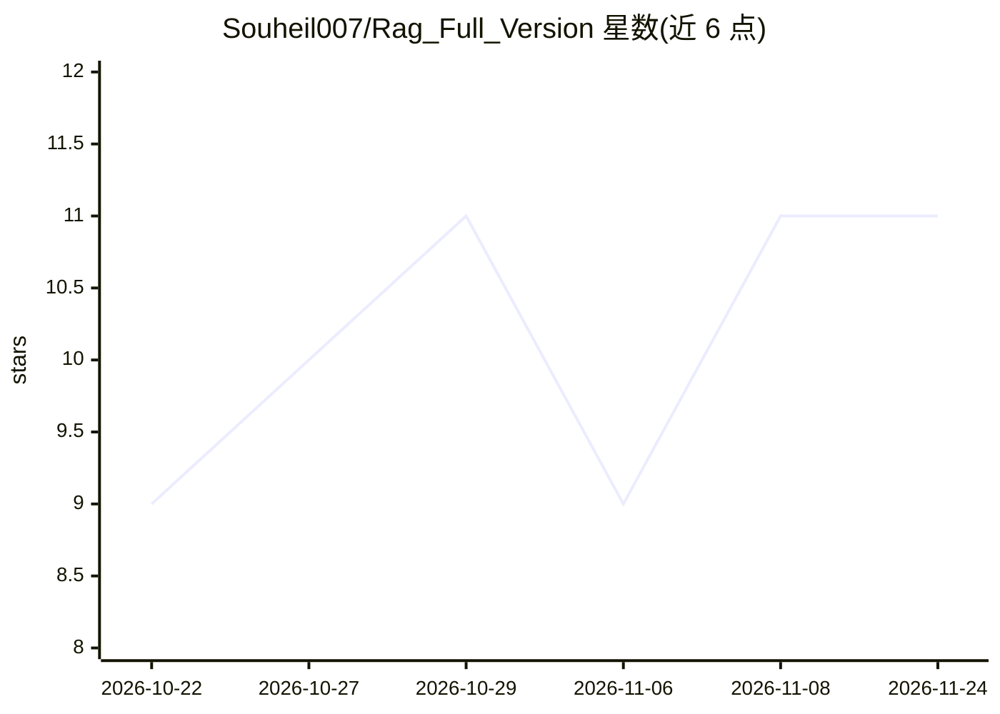

# Souheil007/Rag_Full_Version

⭐ 11 · Python · MIT · 推送 2026-10-17 · [GitHub](https://github.com/Souheil007/Rag_Full_Version) · 个人维护

**生产级文档 RAG 引擎：AST 解析、混合检索与多层护栏**

基于 FastAPI 的文档 RAG 系统：用 IBM Docling 做版面分析与 AST 构建，表格未通过完整性检查时调用 Pixtral-12B 视觉模型修复转录；生成键值句与 Markdown 双重表示，分别写入 ChromaDB 与 BM25 索引；查询阶段并行稠密/稀疏检索，经 RRF 融合与 Cross-Encoder 重排，生成后由三层护栏（引用正则校验、蕴含检测、拒绝回退）验证。提供语义缓存、Langfuse/Sentry 可观测性，Docker 与本地 Python 两种部署方式。

## 筛选速览

| 维度 | 判定 | 备注 |
|---|---|---|
| AI 角色 | `ai-native` | 本体是模型或模型工具 |
| 许可风险 | `permissive` | MIT |
| 部署形态 | `self-host` | docker 或自建部署 |
| 模型依赖 | — | README 未给出锁定关系 |
| 硬件要求 | — | 无带数字的原话,不猜 |
| 安装摩擦 | `low` | 无编译、无系统依赖或容器化 |
| 成熟度 | — | 结构信号不足 |

## 能力要点

- Docling AST 解析与 Pixtral VLM 表格自动修复
- BM25+稠密向量混合检索，RRF 融合与 Cross-Encoder 重排
- 三层护栏：确定性引用校验、蕴含检测、安全回退
- 语义缓存、Langfuse 追踪与 Sentry 错误监控

## 适用场景

- 对含复杂表格的 PDF 建立可溯源的问答索引
- 需要引用校验与幻觉拦截的生产环境 RAG 服务
- 构建带缓存与可观测性的低延迟检索 API

## 场景标签

`RAG` `文档解析` · 领域:知识与检索

## 证据(README 行号)

> L3: > **Enterprise-grade Document RAG with IBM Docling AST parsing, automated VLM table repair (Pixtral-12B), dual-repre
> L52: * **VLM Table Repairer**: If a table fails sanity checks (e.g., column-swapped borderless grid), it routes page ima
> L66: 6. **LLM Generation**: `LLMClient` calls the selected provider (`Mistral`, `Gemini`, `OpenAI`, or `Anthropic`) to g

## 星数曲线

2026-10-22 9 → 2026-11-24 11（+2）

---
*卡片 v1 · prompt 1.4 · 生成 2026-11-18 · 置信度 high · 依据 README sha `47afe681eb45` · [字段定义](../../DATASET.md)*
