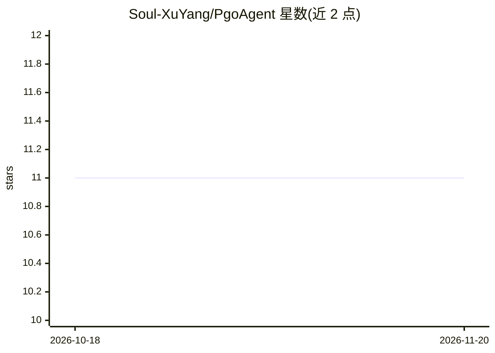

# Soul-XuYang/PgoAgent

⭐ 11 · Python · MIT · 推送 2026-04-24 · [GitHub](https://github.com/Soul-XuYang/PgoAgent) · 个人维护 · 中文 README

**面向开发者的多智能体系统：长短期记忆+MCP+Agentic RAG**

由 Python 智能体核心与 Go Web 服务端组成的智能体系统：Python 侧基于 LangGraph 以 Supervisor 模式调度 Decision/Planner/Worker/Memory 多个子 Agent，集成双阈值混合检索（向量+BM25）+Rerank 的 Agentic RAG、MCP 工具接入、Skill 技能系统与超时保护；LLM 通过 vLLM 本地部署或网络 API 调用。Go 侧以 Gin/GORM/gRPC 承接用户注册登录、会话管理、SSE 流式推送与鉴权限流；数据由 PostgreSQL（记忆/用户数据）与 ChromaDB（向量）存储，并提供 Qwen3 模型的 LoRA 微调流程。

## 筛选速览

| 维度 | 判定 | 备注 |
|---|---|---|
| AI 角色 | `ai-native` | 本体是模型或模型工具 |
| 许可风险 | `permissive` | MIT |
| 部署形态 | `None` |  |
| 模型依赖 | local-ok | 支持本地模型 |
| 硬件要求 | `gpu-8g` | |
| 安装摩擦 | `low` | 无编译、无系统依赖或容器化 |
| 成熟度 | — | 结构信号不足 |

## 能力要点

- Supervisor 模式父子图协作：Decision 调度、Planner 规划、Worker 执行、Memory 记忆管理
- Agentic RAG 采用向量+BM25 混合检索与 Rerank，作者报告召回率约提升 10.7% 的自测实验
- 可扩展的 Skill 技能系统（内置 RAGSkill/TerminalSkill），按 capability 标签懒加载
- Go 服务端通过 gRPC 与 SSE 实现流式对话，支持用户画像的自定义、修改与删除

## 适用场景

- 搭建带长期记忆与用户画像的本地多智能体对话服务
- 为私有知识库构建检索增强问答系统
- 对本地部署的小模型做 LoRA 微调并重新接入推理服务
- 按 MCP 协议接入外部工具（如高德地图）扩展 Agent 能力

## 场景标签

`Agent 框架` `Agent 记忆` `多智能体` `RAG` · 领域:Agent 开发

## 证据(README 行号)

> L4: 本项目是一个具备长期与短期记忆、多代理协作处理能力、本地工具集成及检索增强生成功能的**PgoAgent**的智能体系统(基于**Langgraph + Chromadb + Agentic Rag + MCP**系统)。它采用**
> L22: - **父子图协作 (Orchestration)**: 采用 **Supervisor (主管)** 模式，将复杂任务解耦为多个独立子图，由中心调度器动态分发任务：
> L27: - **Agentic RAG**: 本项目使用Agentic RAG(Retrieval Augmented Generation)并采用双阈值+混合检索(向量检索 + BM25 关键词检索)+ Rerank的方式进行检索，可进

## 星数曲线

2026-10-18 11 → 2026-11-20 11（+0）

---
*卡片 v1 · prompt 1.4 · 生成 2026-11-18 · 置信度 high · 依据 README sha `2a6405338552` · [字段定义](../../DATASET.md)*
