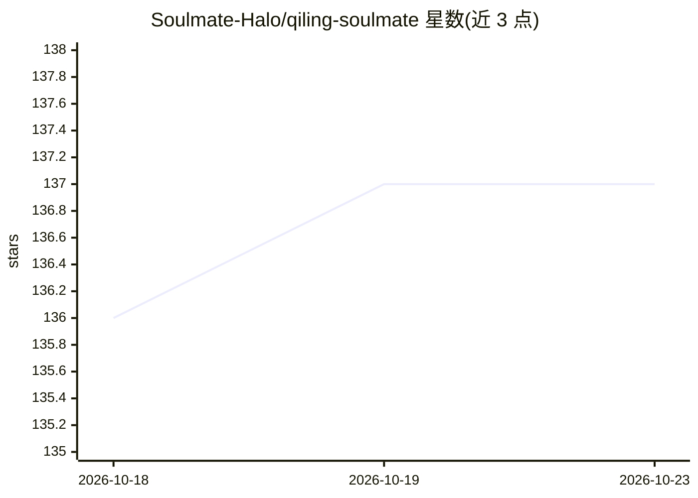

# Soulmate-Halo/qiling-soulmate

⭐ 137 · 推送 2026-10-22 · [GitHub](https://github.com/Soulmate-Halo/qiling-soulmate) · [官网](https://qiling.swcbg.com) · 个人维护 · 中文 README

**商业 AI 编程助手产品的社区与运营入口仓库**

器灵 Soulmate 是一款商业桌面端 AI 编程助手，采用主模型决策、弱模型执行的编排思路，将多个 Agent CLI 聚合到统一工作台，提供成本控制（缓存与历史检索策略）、任务委派（探索/编码分离与并发设置）与线索流（长任务里程碑追踪）功能。本仓库是其社区与运营入口，不含产品源码；桌面核心运行时、编排策略、商业服务端均闭源。提供 Windows 公测安装包下载，通过官网获取产品。

## 筛选速览

| 维度 | 判定 | 备注 |
|---|---|---|
| AI 角色 | `ai-ecosystem` | LLM/agent 周边工具 |
| 许可风险 | `none` | — |
| 部署形态 | `None` |  |
| 模型依赖 | — | README 未给出锁定关系 |
| 硬件要求 | — | 无带数字的原话,不猜 |
| 安装摩擦 | `low` | 无编译、无系统依赖或容器化 |
| 成熟度 | `idea` | |

## 能力要点

- 主模型分解任务与终审，弱模型执行检索/编码等机械步骤
- 成本控制：稳定前缀缓存与受控历史检索，展示各策略估算
- 三选一路线：Fast/Accurate/Economical，单任务仅启用一条
- 多条基于账本记录的对话成本对比案例（5/37/246 轮）

## 适用场景

- 在多个 Agent CLI 间选择、路由并排观察执行
- 长任务开发中降低主模型 token 消耗
- 追踪多轮长任务的进度与关键决策

## 场景标签

`编码 Agent` · 领域:编码与开发

## 证据(README 行号)

> L58: 器灵 Soulmate (Soulmate) is a **local-first** AI programming assistant product. Instead of running one assistant at a
> L137: Soulmate is a commercial desktop product — this repository is its community and operations entry point, not a sour

## 星数曲线

2026-10-18 136 → 2026-10-23 137（+1）

---
*卡片 v1 · prompt 1.4 · 生成 2026-10-22 · 置信度 high · 依据 README sha `1e4d40213e81` · [字段定义](../../DATASET.md)*
