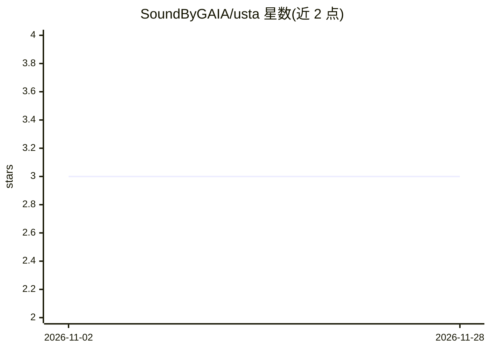

# SoundByGAIA/usta

⭐ 3 · Python · Apache-2.0 · 推送 2026-11-21 · [GitHub](https://github.com/SoundByGAIA/usta) · 组织维护

**面向无编码者与小模型开发者的开源本地 AI 编码代理**

用土耳其语编写的开源 AI 编码助手：用户以自然语言下达任务，代理在指定工作文件夹内读写文件、运行命令，结果在浏览器面板展示，所有改动可两键撤销。核心机制为面向小模型的 harness：承诺-行动核验（默认开启，9B 模型任务成功率从 13/25 升至 19/25）、Docker 沙箱断网执行、来源痕迹门与审计日志。模型可任选本地（Ollama、llama.cpp）或 OpenAI 兼容端点。处于早期版本 0.8.x，命令与 API 可能变动。

## 筛选速览

| 维度 | 判定 | 备注 |
|---|---|---|
| AI 角色 | `ai-native` | 本体是模型或模型工具 |
| 许可风险 | `permissive` | Apache-2.0 |
| 部署形态 | `library` | 以包/库形式分发 |
| 模型依赖 | local-ok | 支持本地模型 |
| 硬件要求 | — | 无带数字的原话,不猜 |
| 安装摩擦 | `low` | 无编译、无系统依赖或容器化 |
| 成熟度 | `idea` | |

## 能力要点

- 面向小/本地模型的 harness：承诺-行动核验等机制带公开测量数据
- Docker 沙箱断网运行、工作区外禁写、任务级两键撤销等安全设计
- 支持 OpenAI 兼容端点及本地 Ollama、llama.cpp
- 浏览器面板提供实时流、差异查看、文件浏览与站点预览

## 适用场景

- 不懂代码的人用土耳其语让 AI 生成并打开一个网页
- 开发者用 4 GB 显存的本地小模型完成日常编码任务
- 需要在沙箱中安全运行 AI 命令并保留审计记录

## 场景标签

`编码 Agent` · 领域:编码与开发

## 证据(README 行号)

> L5: Usta, bilgisayarında senin yerine iş yapan açık kaynak bir yapay zekâ yardımcısı. Ne istediğini yazarsın ("bana
> L12: - Küçük, yerel bir modelle (4 GB ekran kartı yeter) iş görmek isteyen geliştirici.
> L40: Büyük modeller zaten iyi iş çıkarıyor. Küçük modeller ise yarı yolda bırakıyor: "dosyaya yazdım" deyip yazmıyorlar,

## 星数曲线

2026-11-02 3 → 2026-11-28 3（+0）

---
*卡片 v1 · prompt 1.4 · 生成 2026-11-22 · 置信度 high · 依据 README sha `a89b9f55454b` · [字段定义](../../DATASET.md)*
