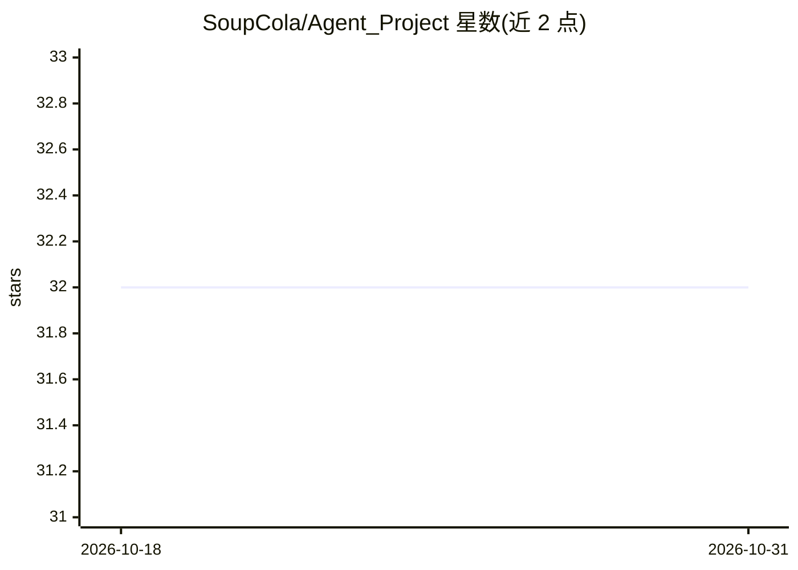

# SoupCola/Agent_Project

⭐ 32 · Python · 推送 2025-12-29 · [GitHub](https://github.com/SoupCola/Agent_Project) · 个人维护 · 中文 README

**集成 RAG、网络搜索与任务规划的中文 Agent 项目**

基于 LangChain/LangGraph 的多模块集成项目：RAG 模块用本地 bce-embedding-base_v1 嵌入模型与 Chroma 向量库检索本地 PDF 知识库，ms-marco-MiniLM-L-6-v2 交叉编码器重排序；Agent 模块在 RAG 与网络搜索间自动路由；Manus 模块基于 LangGraph 做多步骤任务分解执行；MCP 模块接入本地与远程工具服务（时间、地图等）。推理通过 API 调用大语言模型（OpenAI/智谱等）。模型文件不自动下载，需手动准备并指定本地路径，运行需配置 .env 环境变量，以 langgraph dev 启动开发服务器。

## 筛选速览

| 维度 | 判定 | 备注 |
|---|---|---|
| AI 角色 | `ai-native` | 本体是模型或模型工具 |
| 许可风险 | `none` | — |
| 部署形态 | `library` | 以包/库形式分发 |
| 模型依赖 | — | README 未给出锁定关系 |
| 硬件要求 | — | 无带数字的原话,不猜 |
| 安装摩擦 | `low` | 无编译、无系统依赖或容器化 |
| 成熟度 | — | 结构信号不足 |

## 能力要点

- 本地知识库检索 + 网络搜索 + 交叉编码器重排序
- Agent 自动决策 RAG 与网络搜索的使用时机
- 基于 LangGraph 的 Manus 多步骤任务执行框架
- MCP 协议接入本地与远程工具服务（时间查询、地图等）

## 适用场景

- 搭建能同时检索本地知识库和联网搜索的问答 Agent
- 对本地 PDF 文档做 RAG 检索问答
- 通过 Manus 框架自动分解并执行多步骤任务

## 场景标签

`Agent 框架` `RAG` `聊天机器人` · 领域:Agent 开发

## 证据(README 行号)

> L3: 这是一个多个项目的集成项目，深度融合了RAG（检索增强生成）、网络搜索、任务规划执行（Manus）和MCP（模型协调协议）等多项前沿AI技术。项目能够在检索本地知识库的同时进行网络搜索，并通过任务规划执行框架自主完成复杂任务，所有这
> L78: 2. **RAG模块**
> L107: - OpenAI/GPT模型

## 星数曲线

2026-10-18 32 → 2026-10-31 32（+0）

---
*卡片 v1 · prompt 1.4 · 生成 2026-10-26 · 置信度 mid · 依据 README sha `d4faf7b23fe2` · [字段定义](../../DATASET.md)*
