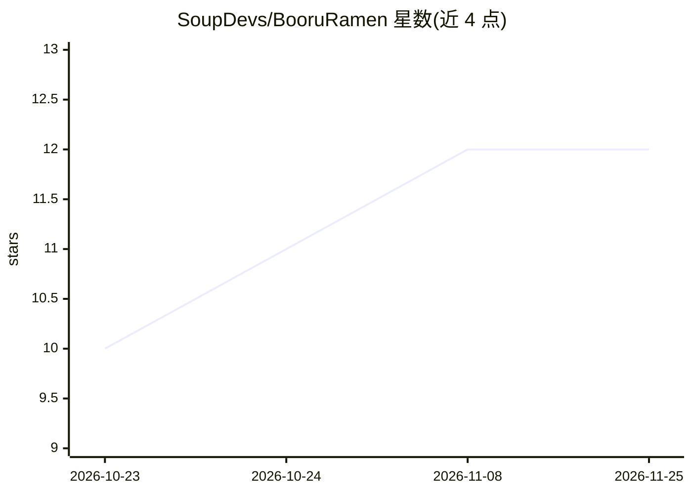

# SoupDevs/BooruRamen

⭐ 12 · JavaScript · GPL-3.0 · 推送 2026-11-16 · [GitHub](https://github.com/SoupDevs/BooruRamen) · 组织维护

**本地学习你喜好的 booru 图站个性化浏览与推荐客户端**

将 Danbooru、Gelbooru、Moebooru 系站点聚合为单一信息流的桌面/Android 客户端。客户端推荐算法根据点赞、跳过、收藏与观看时长在本设备上调整内容排序，支持 Deep Dive 相关内容探索、多来源混合、自定义 profile 导出与标签偏好分析；可选下载本地图像打标模型辅助理解图片标签，不上传数据。提供 Windows 安装包、Android APK 与源码运行方式，支持 .js 插件扩展排序与界面。

## 筛选速览

| 维度 | 判定 | 备注 |
|---|---|---|
| AI 角色 | `ai-enhanced` | 去掉 AI 部分产品仍成立 |
| 许可风险 | `viral` | GPL-3.0 |
| 部署形态 | `desktop` | 安装包/桌面程序 |
| 模型依赖 | — | README 未给出锁定关系 |
| 硬件要求 | — | 无带数字的原话,不猜 |
| 安装摩擦 | `low` | 无编译、无系统依赖或容器化 |
| 成熟度 | — | 结构信号不足 |

## 能力要点

- 客户端推荐算法基于点赞/跳过/收藏/观看时长在本设备计算
- 可选本地图像打标模型辅助推荐，不上传数据
- 聚合多个 booru 站点与自定义来源为单一信息流
- 支持 .js 插件修改搜索、排序与界面

## 适用场景

- 在单一信息流中浏览多个 booru 站点的图片和视频
- 无账号无服务器的本地个性化推荐浏览
- 通过插件自定义信息流的排序规则

## 场景标签

`推荐系统` · 领域:学习与行业

## 证据(README 行号)

> L22: - **Private by design.** No accounts, no servers, no tracking. Recommendations
> L24: - **Optional on-device AI tagging.** Download a local image tagger to help the

## 星数曲线

2026-10-23 10 → 2026-11-25 12（+2）

---
*卡片 v1 · prompt 1.4 · 生成 2026-11-18 · 置信度 high · 依据 README sha `cbe7da1372b1` · [字段定义](../../DATASET.md)*
