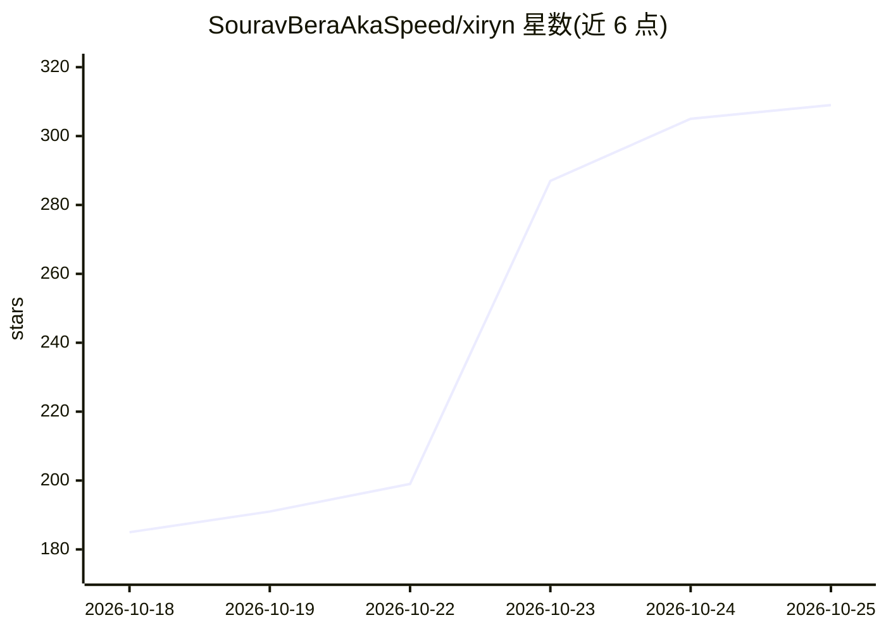

# SouravBeraAkaSpeed/xiryn

⭐ 339 · TypeScript · MIT · 推送 2026-10-24 · [GitHub](https://github.com/SouravBeraAkaSpeed/xiryn) · [官网](https://xiryn.com) · 个人维护

**本地运行的开源个人 agent：每个 agent 有独立 Docker Linux 桌面**

用户在自己电脑上运行的个人 agent 系统：每个 agent 获得独立的沙箱化 Linux 桌面（Docker 容器，含 shell、文件与 Chromium），在后台完成任务并可随时由用户接管。支持 11 个模型提供方含本地 Ollama，BYOK 按量付费，无订阅。数据存于本地 SQLite 文件，登录与支付信息存于 AES-256-GCM 加密保险库，密钥由操作系统保管，agent 不见明文，每次支付需用户批准。通过 Telegram 远程控制，支持例行任务、长期记忆、多 agent 组队与 Firecrawl 网络检索。一键脚本安装 Git/Node.js/Docker 并启动。

## 筛选速览

| 维度 | 判定 | 备注 |
|---|---|---|
| AI 角色 | `ai-native` | 本体是模型或模型工具 |
| 许可风险 | `permissive` | MIT |
| 部署形态 | `self-host` | docker 或自建部署 |
| 模型依赖 | local-ok | 支持本地模型 |
| 硬件要求 | — | 无带数字的原话,不猜 |
| 安装摩擦 | `low` | 无编译、无系统依赖或容器化 |
| 成熟度 | — | 结构信号不足 |

## 能力要点

- 每 agent 独立 Docker Linux 桌面，可实时观看并随时接管
- 11 个模型提供方含本地 Ollama（--local 一键免费本地运行）
- AES-256-GCM 加密保险库存储登录/卡片，agent 不可见明文，支付需逐次批准
- Telegram 远程控制，含移动端实时桌面链接

## 适用场景

- 让 agent 在后台克隆仓库、修 bug、跑测试并给出 diff
- 自动化网页操作：查资料、填表、比价、准备订单，遇到登录/支付/CAPTCHA 时交还给我
- 组建多 agent 小队分工处理研究、写作与工程任务
- 通过 Telegram 从手机查看 agent 进度并批准操作

## 场景标签

`GUI 自动化` `浏览器自动化` `多智能体` · 领域:Agent 开发

## 证据(README 行号)

> L29: **Xiryn is the same idea as an open-source personal agent you run yourself.** Clone it, add your API keys, and you 
> L63: **🧠 Any model, your keys.** OpenAI, Anthropic, Google, xAI, Groq, Mistral, DeepSeek, OpenRouter, Ollama, LM Studio,
> L71: ||**Xiryn**|Hosted agents Muse · Grok Bot · Dots|Local computer-use agents e.g. OpenClaw|

## 星数曲线

2026-10-18 185 → 2026-10-25 309（+124）

---
*卡片 v1 · prompt 1.4 · 生成 2026-10-22 · 置信度 high · 依据 README sha `77cb73123493` · [字段定义](../../DATASET.md)*
