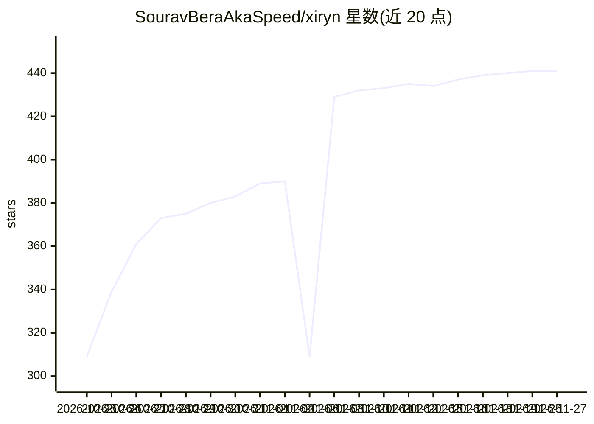

# SouravBeraAkaSpeed/xiryn

⭐ 441 · TypeScript · MIT · 推送 2026-11-02 · [GitHub](https://github.com/SouravBeraAkaSpeed/xiryn) · [官网](https://xiryn.com) · 个人维护

**本地运行的开源个人 Agent：Docker 沙盒桌面 + Telegram 远程控制**

用户在自己电脑上运行的开源个人 Agent 平台：每个 Agent 获得独立的 Docker Linux 沙盒桌面（shell、持久 home、Chromium），可后台执行构建调试、网络研究、写作、表单填写等任务；支持 16 个预置 Agent 与小队协作、定时任务、长期记忆、费用统计与月度预算，敏感凭据存于 AES-256-GCM 加密保险库。通过一条安装脚本完成部署，支持 Telegram 远程控制与实时桌面接管。需约 4GB 磁盘与至少一个模型 API key，或用 Ollama 本地模型免钥运行。

## 筛选速览

| 维度 | 判定 | 备注 |
|---|---|---|
| AI 角色 | `ai-native` | 本体是模型或模型工具 |
| 许可风险 | `permissive` | MIT |
| 部署形态 | `self-host` | docker 或自建部署 |
| 模型依赖 | local-ok | 支持本地模型 |
| 硬件要求 | — | 无带数字的原话,不猜 |
| 安装摩擦 | `low` | 无编译、无系统依赖或容器化 |
| 成熟度 | — | 结构信号不足 |

## 能力要点

- 每个 Agent 独立 Docker 沙盒桌面，与用户系统隔离
- 支持 11 家模型提供商及 OpenAI 兼容端点，按 Agent 选模型
- 加密保险库存凭据，支付需逐步审批，Agent 不接触明文卡号
- Telegram 二维码配对远程控制，无公网 URL/端口转发

## 适用场景

- 让 Agent 在后台替我做代码调试和网络调研
- 通过 Telegram 用手机遥控家里的 Agent 干活
- 不用云托管服务、把对话和凭据留在本地磁盘
- 让多个 Agent 组队分工处理任务

## 场景标签

`AI 助手` `多智能体` `Agent 记忆` · 领域:Agent 开发

## 证据(README 行号)

> L5:  The open-source personal agent. It does everything Muse, Grok Bot and Dots do — on your own computer.
> L29: **Xiryn is the same idea as an open-source personal agent you run yourself.** Clone it, add your API keys, and you 
> L63: **🧠 Any model, your keys.** OpenAI, Anthropic, Google, xAI, Groq, Mistral, DeepSeek, OpenRouter, Ollama, LM Studio,

## 星数曲线

2026-10-25 309 → 2026-11-27 441（+132）

---
*卡片 v1 · prompt 1.4 · 生成 2026-11-25 · 置信度 high · 依据 README sha `3beb6f38672d` · [字段定义](../../DATASET.md)*
