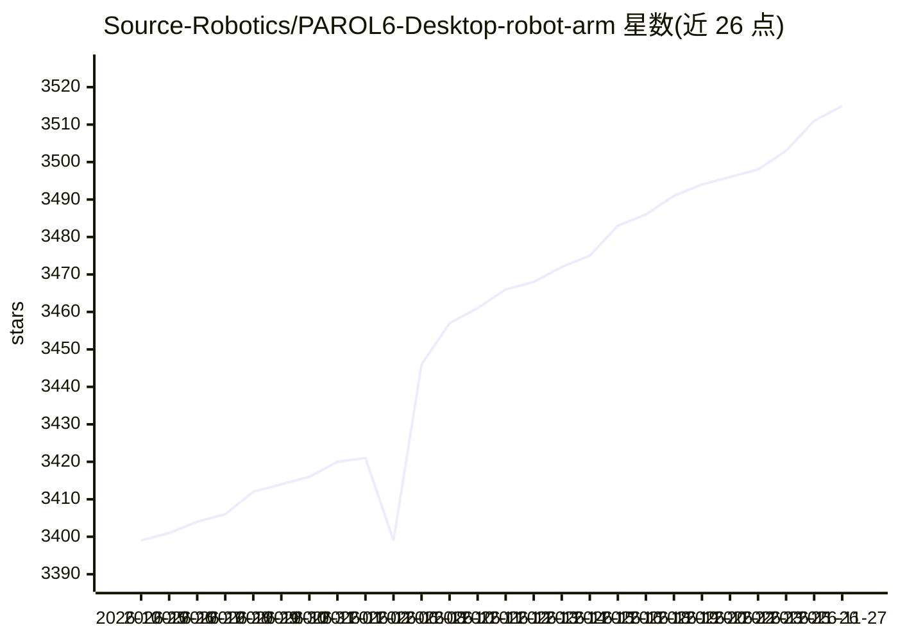

# Source-Robotics/PAROL6-Desktop-robot-arm

⭐ 3,515 · HTML · CERN-OHL-S-2.0 · 推送 2026-11-18 · [GitHub](https://github.com/Source-Robotics/PAROL6-Desktop-robot-arm) · [官网](https://docs.source-robotics.com/PAROL-docs/) · 组织维护

**给机器人爱好者的开源 3D 打印 6 轴桌面机械臂硬件项目**

PAROL6 是一台开源的 3D 打印桌面 6 轴机械臂，机械设计、控制软件与使用方式对标工业机器人；规格为 6 轴、408 mm 臂展、0.5–1 kg 负载、0.1 mm 重复精度、5.5 kg 重量。仓库提供 STL 打印件、逐件带购买链接的 BOM、PDF 装配手册、打印参数表、PlatformIO 控制板固件与测试固件、URDF/MuJoCo 模型及 Leap Motion 手部控制扩展。可购买整件或套件，也可按文档自建。

## 筛选速览

| 维度 | 判定 | 备注 |
|---|---|---|
| AI 角色 | `ai-enhanced` | 去掉 AI 部分产品仍成立 |
| 许可风险 | `viral` | CERN-OHL-S-2.0 |
| 部署形态 | `None` |  |
| 模型依赖 | — | README 未给出锁定关系 |
| 硬件要求 | — | 无带数字的原话,不猜 |
| 安装摩擦 | `low` | 无编译、无系统依赖或容器化 |
| 成熟度 | — | 结构信号不足 |

## 能力要点

- 完整自建资料：STL 打印件、逐件 BOM、装配手册与打印参数表
- 提供 PlatformIO 控制板固件与测试固件
- URDF 与 MuJoCo 模型用于仿真
- 编程途径：Commander 软件、社区版 Waldo Commander、Python API、ROS 2/MoveIt

## 适用场景

- 自行打印零件并组装一台桌面机械臂
- 用 ROS 2 与 MoveIt 做机械臂运动规划实验
- 在 MuJoCo 中对机械臂建模仿真
- 通过 Commander 软件或 Python API 控制机械臂

## 场景标签

 · 领域:机器人/开源硬件

## 证据(README 行号)

> L5:  Open-source 3D-printed 6-axis desktop robot arm.
> L40: |**Program it**|Commander software (tested PCs) · Waldo Commander (community) · Python API (legacy) · ROS 2 and Mov

## 星数曲线

2026-10-25 3,399 → 2026-11-27 3,515（+116）

---
*卡片 v1 · prompt 1.4 · 生成 2026-11-23 · 置信度 mid · 依据 README sha `881d30b9d1df` · [字段定义](../../DATASET.md)*
