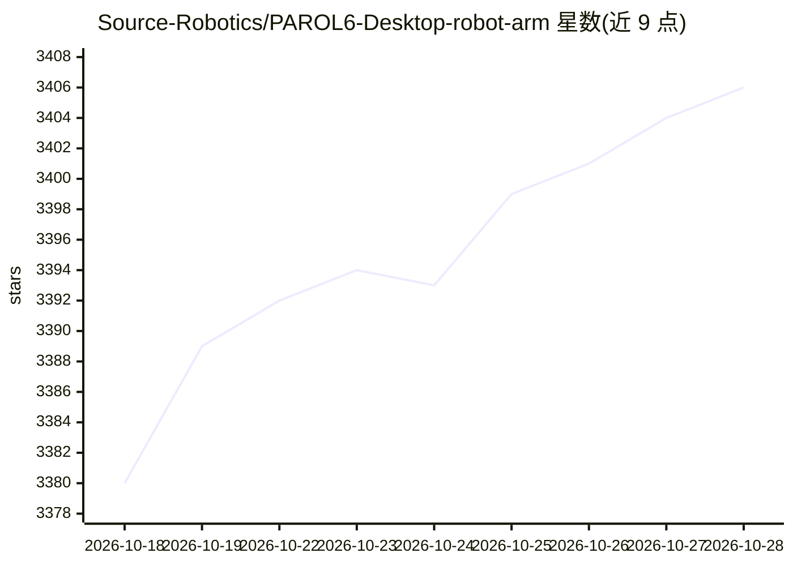

# Source-Robotics/PAROL6-Desktop-robot-arm

⭐ 3,406 · HTML · GPL-3.0 · 推送 2026-10-22 · [GitHub](https://github.com/Source-Robotics/PAROL6-Desktop-robot-arm) · [官网](https://source-robotics.com/) · 组织维护

**3D 打印桌面机械臂的开源硬件项目：BOM/STL/文档**

PAROL6 是一款 3D 打印的桌面六轴机械臂开源项目，机械设计、控制软件、GUI 与 STL 文件均开源，设计目标在机械结构、控制软件与可用性上接近工业机器人。仓库提供 BOM、装配说明、文档与视频教程，可自行采购零件组装，也可在官网购买成品。支持 Commander 桌面软件、网页版 Commander 与 Python API，另有 ROS2/Moveit 仿真资源；社区项目含 GUI、视觉/AI 演示与硬件改装。项目声明涉及危险电压，按 GPLv3 授权（页面顶部另标 MIT 字样）。

## 筛选速览

| 维度 | 判定 | 备注 |
|---|---|---|
| AI 角色 | `ai-enhanced` | 去掉 AI 部分产品仍成立 |
| 许可风险 | `viral` | GPL-3.0 |
| 部署形态 | `None` |  |
| 模型依赖 | — | README 未给出锁定关系 |
| 硬件要求 | — | 无带数字的原话,不猜 |
| 安装摩擦 | `low` | 无编译、无系统依赖或容器化 |
| 成熟度 | `idea` | |

## 能力要点

- 开源机械臂的 STL、BOM 与装配说明
- 提供桌面 Commander、网页 Commander 与 Python API
- ROS2/Moveit 仿真资源
- 社区项目含 GUI、视觉/AI 演示与硬件改装

## 适用场景

- 自行采购零件并组装一台桌面机械臂
- 通过 Python API 或 ROS2/Moveit 对机械臂编程与仿真
- 参考开源硬件设计学习工业风格机械臂结构

## 场景标签

`教程课程` · 领域:学习与行业

## 证据(README 行号)

> L17: PAROL6 is a high-performance 3D-printed desktop robotic arm. The design approach of PAROL6 was to be similar to ind
> L40: - Community projects — GUIs, vision/AI demos, and hardware mods built by the community

## 星数曲线

2026-10-18 3,380 → 2026-10-28 3,406（+26）

---
*卡片 v1 · prompt 1.4 · 生成 2026-10-20 · 置信度 low · 依据 README sha `19c760f3394b` · [字段定义](../../DATASET.md)*
