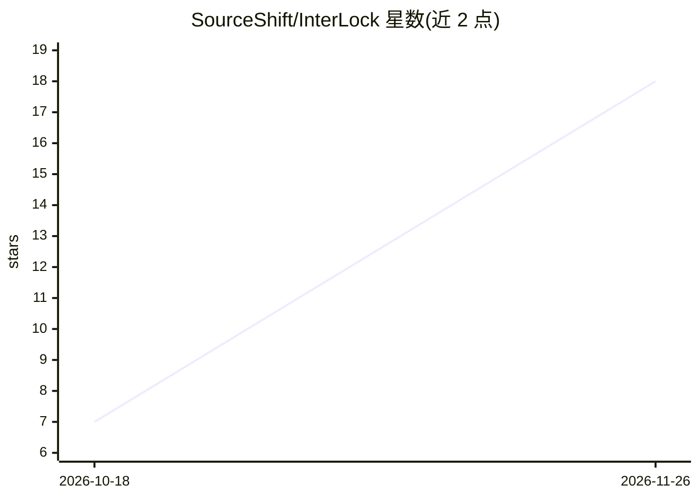

# SourceShift/InterLock

⭐ 18 · Python · NOASSERTION · 推送 2026-11-24 · [GitHub](https://github.com/SourceShift/InterLock) · [官网](https://interlock.sourceshift.ai/) · 组织维护

**给 AI agent 的进程内护栏库：拦截/改写工具与 MCP 调用**

在 agent 自身进程内检查每一次工具调用与工具返回结果，判定为允许、阻止、改写（如掩码敏感信息）或交人工审批四种处置之一，默认 fail-closed。提供 125 个现成检测器（prompt 注入、SQL/shell 注入、PII、SSRF、出网等）、分层策略作用域、带签名的审计日志，以及仅绑定 127.0.0.1 的本地 Web 控制台。纯 Python、无运行时依赖、离线可用；通过装饰器、MCP 会话封装、LangChain 工具封装或 hooks 接入 Claude Code/Codex/Cursor。当前为 Alpha 版，未发布到 PyPI/npm，需从 GitHub 安装。

## 筛选速览

| 维度 | 判定 | 备注 |
|---|---|---|
| AI 角色 | `ai-ecosystem` | LLM/agent 周边工具 |
| 许可风险 | `permissive` | NOASSERTION |
| 部署形态 | `library` | 以包/库形式分发 |
| 模型依赖 | — | README 未给出锁定关系 |
| 硬件要求 | — | 无带数字的原话,不猜 |
| 安装摩擦 | `low` | 无编译、无系统依赖或容器化 |
| 成熟度 | `idea` | |

## 能力要点

- 四种裁决：allow/block/rewrite/escalate（人工一次性审批绑定到具体调用）
- 125 个检测器覆盖 prompt 注入、注入攻击、PII/机密掩码、SSRF、出网、MCP 信任与预算
- 声明式 JSON/YAML 策略、租户级作用域与不可篡改审计日志
- 同一策略经 hooks 保护 Claude Code、Codex 与 Cursor 的工具调用

## 适用场景

- 在 agent 执行 rm、外发数据前按策略拦截或改写调用
- 对 MCP 服务器做允许清单与工具 schema 固定，捕获变更
- 拦截藏在工具返回内容中的注入指令
- 多租户 agent 平台按租户下发策略并留存审计记录

## 场景标签

`网络安全` · 领域:学习与行业

## 证据(README 行号)

> L11: interlock checks every tool call your agent makes, inside the agent's own
> L203: |Node.js client|Guards JS agents with the same Python policy through a local daemon|js/README.md|

## 星数曲线

2026-10-18 7 → 2026-11-26 18（+11）

---
*卡片 v1 · prompt 1.4 · 生成 2026-11-26 · 置信度 mid · 依据 README sha `2ca527b4d1cb` · [字段定义](../../DATASET.md)*
