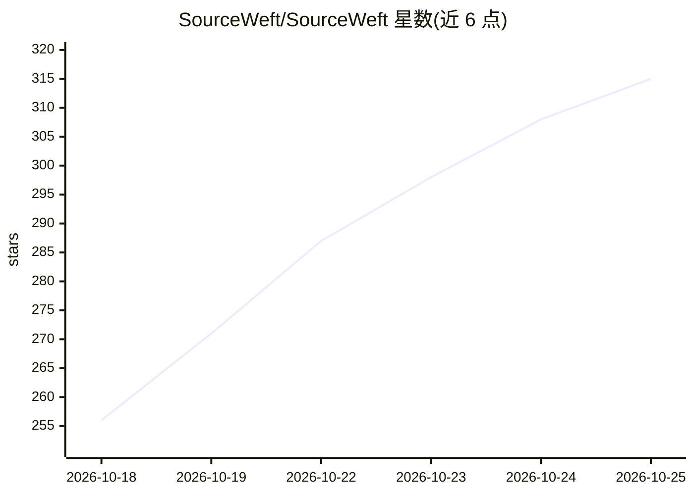

# SourceWeft/SourceWeft

⭐ 315 · TypeScript · NOASSERTION · 推送 2026-10-24 · [GitHub](https://github.com/SourceWeft/SourceWeft) · [官网](https://SourceWeft.com/) · 组织维护 · 中文 README

**可自托管的开源 AI 工作站：多 agent、知识与引用一体化**

面向终端用户与团队的开源自托管 AI 工作站，定位为 ChatGPT 与 NotebookLM 的替代品。用户自带模型与 API key（BYOK），将对话、知识库、工作文件与任务执行放在同一环境：描述任务后由 agent 与子 agent 分解执行，配合技能库、MCP 集成与沙箱命令执行，产出报告、演示文稿、网页、图片等并附带可溯源引用。支持自建数据库与文件存储、角色与访问控制；提供网页端与 macOS/Windows/Linux 桌面客户端，Docker 发布包无需宿主机安装 Node/Rust。

## 筛选速览

| 维度 | 判定 | 备注 |
|---|---|---|
| AI 角色 | `ai-native` | 本体是模型或模型工具 |
| 许可风险 | `permissive` | NOASSERTION |
| 部署形态 | `desktop` | 安装包/桌面程序 |
| 模型依赖 | — | README 未给出锁定关系 |
| 硬件要求 | — | 无带数字的原话,不猜 |
| 安装摩擦 | `low` | 无编译、无系统依赖或容器化 |
| 成熟度 | — | 结构信号不足 |

## 能力要点

- 多 agent 协作与子 agent 任务分解
- 技能库与 MCP 服务器扩展 agent 能力
- 沙箱化命令执行与文件处理
- 知识源（PDF/网页/YouTube/Notion 等）接入与引用溯源
- BYOK 多模型供应商与自托管部署

## 适用场景

- 把论文、网页和笔记整理成带引用的研究简报
- 把课程材料与视频转成学习指南、FAQ 和测验草稿
- 团队共享知识源并生成可溯源的决策与项目答案
- 让 agent 使用工具与技能生成报告、演示文稿和网页草稿

## 场景标签

`多智能体` `聊天机器人` `知识库管理` `文档问答` · 领域:Agent 开发

## 证据(README 行号)

> L25: **SourceWeft** is an open-source alternative to ChatGPT and NotebookLM that you can self-host on your own machine o
> L35: - **Multiple models & BYOK.** Choose supported model providers and bring your own API keys. Configure models for ch

## 星数曲线

2026-10-18 256 → 2026-10-25 315（+59）

---
*卡片 v1 · prompt 1.4 · 生成 2026-10-22 · 置信度 high · 依据 README sha `1bdb06affc5d` · [字段定义](../../DATASET.md)*
