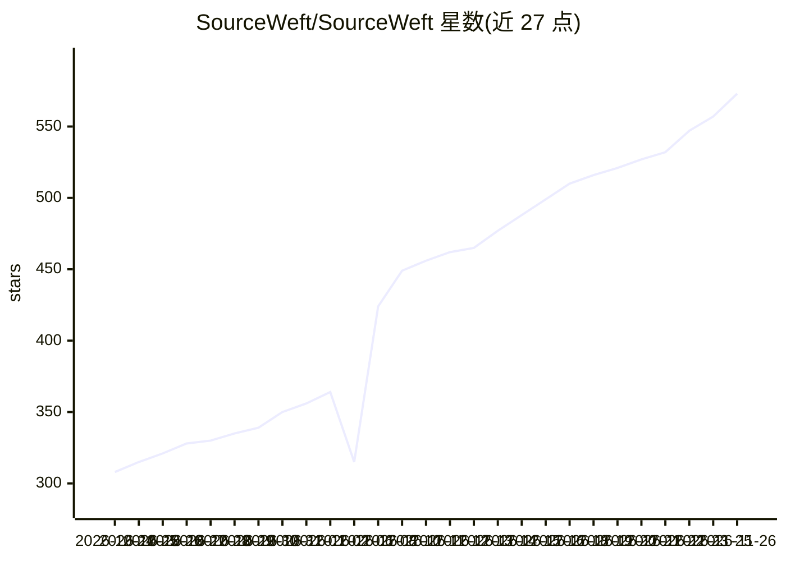

# SourceWeft/SourceWeft

⭐ 573 · TypeScript · NOASSERTION · 推送 2026-11-25 · [GitHub](https://github.com/SourceWeft/SourceWeft) · [官网](https://SourceWeft.com/) · 组织维护 · 中文 README

**自托管的开源 ChatGPT/NotebookLM 替代：AI 工作站**

开源可自托管的工作站应用，将对话、知识库、工作文件与任务执行整合在一起。核心机制包括：多智能体与子智能体分工协作、可扩展的技能库与 MCP 集成、沙箱化命令执行（需配置运行时并经批准）、BYOK 接入多家模型服务商的 API key、引用可回溯到原始来源的知识管理。提供 macOS/Windows/Linux 桌面安装包与 Docker 自托管部署（含 web、API、数据库、文件存储），支持团队工作区与角色权限。

## 筛选速览

| 维度 | 判定 | 备注 |
|---|---|---|
| AI 角色 | `ai-native` | 本体是模型或模型工具 |
| 许可风险 | `permissive` | NOASSERTION |
| 部署形态 | `desktop` | 安装包/桌面程序 |
| 模型依赖 | — | README 未给出锁定关系 |
| 硬件要求 | — | 无带数字的原话,不猜 |
| 安装摩擦 | `low` | 无编译、无系统依赖或容器化 |
| 成熟度 | — | 结构信号不足 |

## 能力要点

- 多智能体协作与子智能体分工，共享工作上下文
- MCP 服务器集成与沙箱化执行环境
- 知识来源覆盖 PDF/网页/Notion/Google Drive/Slack 等，引用可回溯原文
- BYOK 自带 API key，自托管数据库与文件存储

## 适用场景

- 把论文、网页和笔记整理成带引用的研究简报
- 用课程材料和视频生成学习指南与测验草稿
- 团队共享工作区中就决策和项目做可溯源问答
- 自托管部署，用自己的模型与密钥处理内部资料

## 场景标签

`多智能体` `聊天机器人` `RAG` `知识库管理` · 领域:Agent 开发

## 证据(README 行号)

> L25: **SourceWeft** is an open-source alternative to ChatGPT and NotebookLM that you can self-host on your own machine o
> L35: - **Multiple models & BYOK.** Choose supported model providers and bring your own API keys. Configure models for ch

## 星数曲线

2026-10-24 308 → 2026-11-26 573（+265）

---
*卡片 v1 · prompt 1.4 · 生成 2026-11-25 · 置信度 high · 依据 README sha `d9f755afde44` · [字段定义](../../DATASET.md)*
