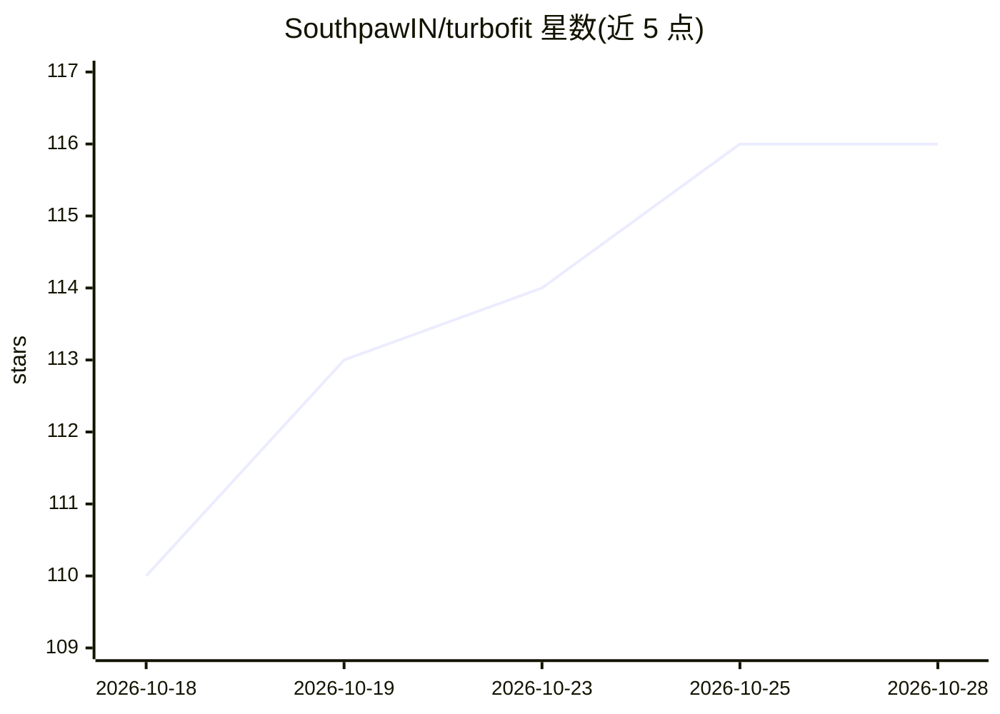

# SouthpawIN/turbofit

⭐ 116 · Python · MIT · 推送 2026-10-25 · [GitHub](https://github.com/SouthpawIN/turbofit) · 个人维护

**Hermes Agent 的自适应本地推理运行时与模型选配提供方**

TurboFit 是 Hermes Agent 的一等模型 provider 与自适应本地推理运行时：扫描本机硬件（GPU VRAM 或统一内存）后，按两条 Fit Ladder（GPU 密集梯队 / CPU 与 Mac 的 MoE 梯队）填充模型列表，置顶可持久的最佳选择（auto 模型），并在 OOM/超时时按列表逐级回退。启动原生后端并暴露 OpenAI 兼容端点（127.0.0.1:8091）。安装走 Hermes 插件、TurboSouth bot 或 git clone 手动路径；内置 Tailscale 后端实现跨设备模型联邦。README 自述多数本地基准数据仍缺失（'#1 evidence gap'），DeepSeek V4.1 原生引擎仍在测试中。

## 筛选速览

| 维度 | 判定 | 备注 |
|---|---|---|
| AI 角色 | `ai-ecosystem` | LLM/agent 周边工具 |
| 许可风险 | `permissive` | MIT |
| 部署形态 | `None` |  |
| 模型依赖 | — | README 未给出锁定关系 |
| 硬件要求 | — | 无带数字的原话,不猜 |
| 安装摩擦 | `medium` | 含编译或系统依赖之一 |
| 成熟度 | `idea` | |

## 能力要点

- 按硬件内存分层填充模型列表，auto 模型为最大可持久档位，OOM 时沿 Fit List 逐级回退
- 两条 Fit Ladder：GPU 密集模型梯队与 CPU/Apple Silicon 的 MoE 梯队
- 暴露单一 OpenAI 兼容网关端点，TTS/STT 经同一网关运行
- Tailscale 内置后端：无公网端口暴露，跨设备模型列表自动联邦

## 适用场景

- 让 Hermes Agent 在本机自动选配可运行的最大模型并自动回退
- 在不同显存/内存档位的机器上获得对应的模型量化配置
- 通过私有 tailnet 从其他设备访问本机模型网关

## 场景标签

`推理引擎` `模型网关` · 领域:Agent 开发

## 证据(README 行号)

> L7: TurboFit is a first-class Hermes Agent provider and adaptive local-inference runtime. It inventories your physical c
> L39: > `serve auto` scans the machine, builds the fit chain from the right ladder, picks the largest sustainable rung, a

## 星数曲线

2026-10-18 110 → 2026-10-28 116（+6）

---
*卡片 v1 · prompt 1.4 · 生成 2026-10-23 · 置信度 high · 依据 README sha `5552e55cb4ea` · [字段定义](../../DATASET.md)*
