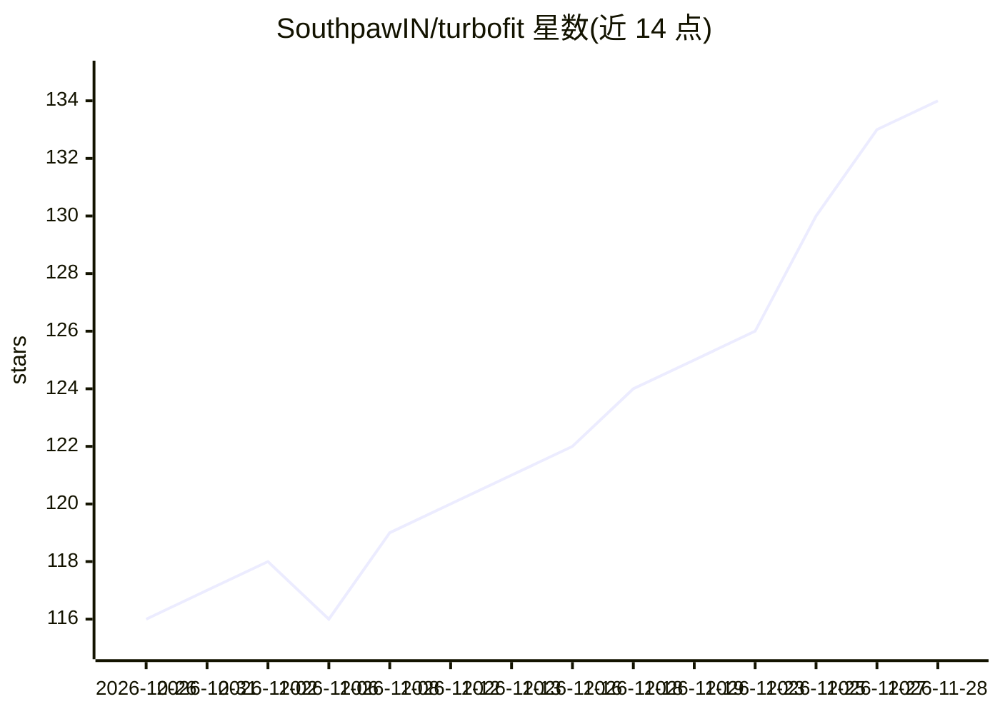

# SouthpawIN/turbofit

⭐ 134 · Python · MIT · 推送 2026-11-24 · [GitHub](https://github.com/SouthpawIN/turbofit) · 个人维护

**Hermes Agent 的本地推理插件：按硬件自动选模型并让出 GPU**

TurboFit 是 Hermes Agent 的本地推理 provider 插件：扫描主机硬件，从目录中下载可容纳的模型并保持驻留，经网关 :8091 提供服务；当游戏、渲染等任务占用 GPU 时按 fallback 链逐级降级——先收缩上下文，再换小模型，再释放驻留，压力解除后恢复。自称多引擎协调器而非 llama.cpp 包装，按模型 recipe 分派 llama.cpp、Strata、vLLM、Basalt 或媒体运行时。目录含 87 个模型、302 行配置，条目固定 Hugging Face revision 与 sha256。默认经 Tailscale Serve 发布端点，可用 publish_tailnet: false 关闭。

## 筛选速览

| 维度 | 判定 | 备注 |
|---|---|---|
| AI 角色 | `ai-ecosystem` | LLM/agent 周边工具 |
| 许可风险 | `permissive` | MIT |
| 部署形态 | `None` |  |
| 模型依赖 | local-ok | 支持本地模型 |
| 硬件要求 | `gpu-8g` | |
| 安装摩擦 | `low` | 无编译、无系统依赖或容器化 |
| 成熟度 | — | 结构信号不足 |

## 能力要点

- /turbofit setup 探测硬件、选模型、下载、启动运行时并接入 Hermes
- fallback 链降级顺序：上下文→模型类→整体释放，压力清除后自恢复
- 多引擎分派：llama.cpp、Strata、vLLM、Basalt 及图像/视频/语音媒体运行时
- fallback 链可经 ~/.config/turbofit/fallback-chain.json 自定义，可指向其他节点端点

## 适用场景

- 让 Hermes Agent 在不同配置的机器上自动获得可运行的本地模型
- GPU 需要同时跑游戏或渲染时自动让出显存并在空闲后恢复
- 多台机器通过 Tailscale 互相调用对方节点上的模型

## 场景标签

`推理引擎` `模型网关` · 领域:Agent 开发

## 证据(README 行号)

> L7: TurboFit is a first-class Hermes Agent provider for local inference. Install it, pick `auto`, and stop thinking abou
> L9: It is not a llama.cpp wrapper. TurboFit is a **multi-engine coordinator**: one catalog, one fit ladder, one gateway,

## 星数曲线

2026-10-26 116 → 2026-11-28 134（+18）

---
*卡片 v1 · prompt 1.4 · 生成 2026-11-28 · 置信度 high · 依据 README sha `042d7feedb46` · [字段定义](../../DATASET.md)*
