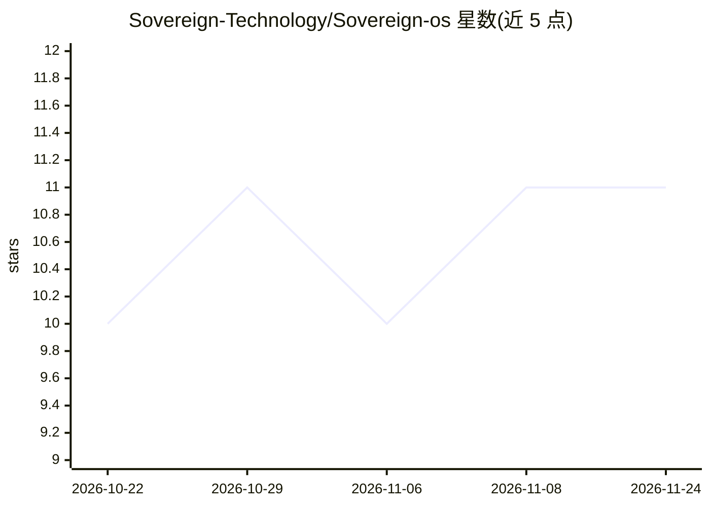

# Sovereign-Technology/Sovereign-os

⭐ 11 · HTML · NOASSERTION · 推送 2026-03-06 · [GitHub](https://github.com/Sovereign-Technology/Sovereign-os) · [官网](https://sovereign-technology.github.io/Sovereign-os/) · 个人维护

**浏览器内运行的 P2P 去中心化身份与通信环境**

完全在浏览器中运行的自主权点对点操作环境，无需服务器、账户，密钥/消息/文件仅存于用户设备。v6.0 提供身份金库（W3C 可验证凭证签发/持有/撤销、Shamir 3-of-5 密钥恢复、密钥轮换）、P2P DAO 治理（提案/投票/法定人数）、12 状态机 FSM 内核、多中继故障转移、CRDT 同步、存储转发队列与对等节点声誉评分。运行方式为静态文件经 HTTP 提供，无安装构建步骤。README 声明为双许可。

## 筛选速览

| 维度 | 判定 | 备注 |
|---|---|---|
| AI 角色 | `ai-enhanced` | 去掉 AI 部分产品仍成立 |
| 许可风险 | `none` | NOASSERTION |
| 部署形态 | `library` | 以包/库形式分发 |
| 模型依赖 | — | README 未给出锁定关系 |
| 硬件要求 | — | 无带数字的原话,不猜 |
| 安装摩擦 | `low` | 无编译、无系统依赖或容器化 |
| 成熟度 | — | 结构信号不足 |

## 能力要点

- W3C 可验证凭证与 Shamir 3-of-5 密钥恢复（含打印备份卡）
- P2P DAO 治理：提案提交、签名投票、法定人数自动计票
- FSM 内核 12 台机器 12 条不变量，Merkle 快照离线验证
- 多中继故障转移、CRDT 同步、512KB/节点离线加密队列

## 适用场景

- 在无服务器的浏览器环境中管理去中心化身份与凭证
- 通过 P2P 网格与同伴进行端到端加密通信
- 在小型社区内运行链下式 DAO 提案与投票

## 场景标签

 · 领域:去中心化身份与通信

## 证据(README 行号)

> L3: **A self-sovereign, peer-to-peer operating environment that runs entirely in your browser.**
> L74: **No install. No build. No server.**

## 星数曲线

2026-10-22 10 → 2026-11-24 11（+1）

---
*卡片 v1 · prompt 1.4 · 生成 2026-11-18 · 置信度 mid · 依据 README sha `27c42ea241c8` · [字段定义](../../DATASET.md)*
