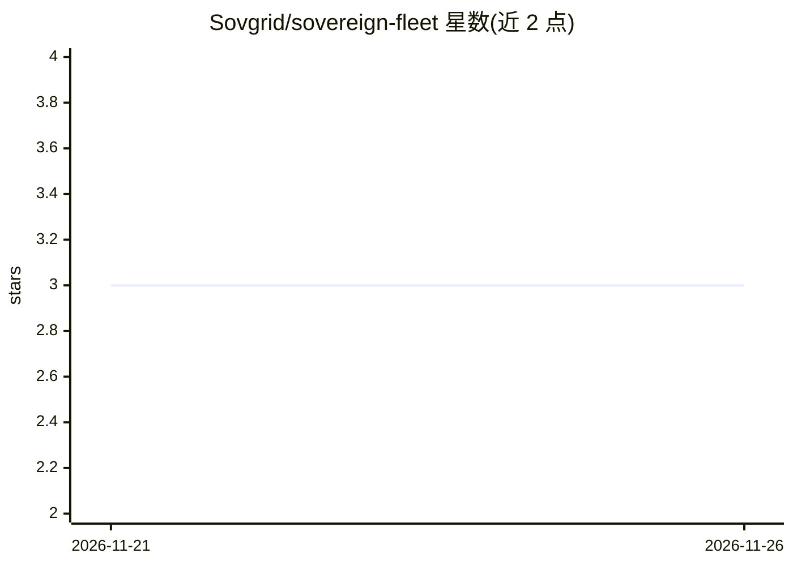

# Sovgrid/sovereign-fleet

⭐ 3 · Python · MIT · 推送 2026-11-23 · [GitHub](https://github.com/Sovgrid/sovereign-fleet) · [官网](https://sovgrid.org/fleet/) · 个人维护

**为自主编码 agent CLI 提供内核级沙箱任务队列与路由调度**

Sovereign Fleet 在自有硬件上运行多种编码 agent CLI（Goose、Claude Code、OpenCode、Aider 等），每个任务在独立 git worktree 中执行，由 Linux 内核 Landlock + seccomp 直接限制文件写入、阻止 ~/.ssh 访问并强制出站端口白名单。通过 Thompson 采样在（harness × model）组合间路由，覆盖本地模型服务器、免费云层级与订阅账户，并按配额策略控制支出。每次运行需通过范围检查、AST 语法检查、仓库门禁与任务门禁后方可合并或开 PR。提供队列、MCP 服务器与移动端 PWA 面板。沙箱要求 Linux 内核 6.12+（Landlock ABI 6），否则拒绝运行，当前为 beta 状态。

## 筛选速览

| 维度 | 判定 | 备注 |
|---|---|---|
| AI 角色 | `ai-ecosystem` | LLM/agent 周边工具 |
| 许可风险 | `permissive` | MIT |
| 部署形态 | `library` | 以包/库形式分发 |
| 模型依赖 | — | README 未给出锁定关系 |
| 硬件要求 | — | 无带数字的原话,不猜 |
| 安装摩擦 | `low` | 无编译、无系统依赖或容器化 |
| 成熟度 | `idea` | |

## 能力要点

- Landlock ABI 6 + seccomp 内核级沙箱，无 Docker 开销的无人值守运行
- Thompson 采样（harness × model）路由，按成本加权正确分钟数排序
- 确定性质量门禁：范围检查、AST 语法、仓库门禁、任务门禁，无凭据沙箱内执行
- 移动 PWA、17 工具 MCP 服务器、ntfy/Matrix/Nostr 多通道派发与审批

## 适用场景

- 在自己的硬件上无人值守运行编码 agent 批量处理任务
- 将本地模型、免费额度与订阅配额组合调度以控制编码 agent 成本
- 要求 agent 产出必须通过独立测试门禁后才落地分支或 PR
- 通过手机 PWA 或 Matrix 消息远程审批编码任务

## 场景标签

`编码 Agent` · 领域:编码与开发

## 证据(README 行号)

> L14:  Kernel-sandboxed task queue, Thompson-sampling <code>(harness × model)</code> router, deterministic quality gates,
> L29: Sovereign Fleet runs coding-agent CLIs (**Goose**, **Claude Code**, **OpenCode**, **Pi**, **Aider**, **Antigravity 

## 星数曲线

2026-11-21 3 → 2026-11-26 3（+0）

---
*卡片 v1 · prompt 1.4 · 生成 2026-11-22 · 置信度 high · 依据 README sha `c92ce4e4fc3a` · [字段定义](../../DATASET.md)*
