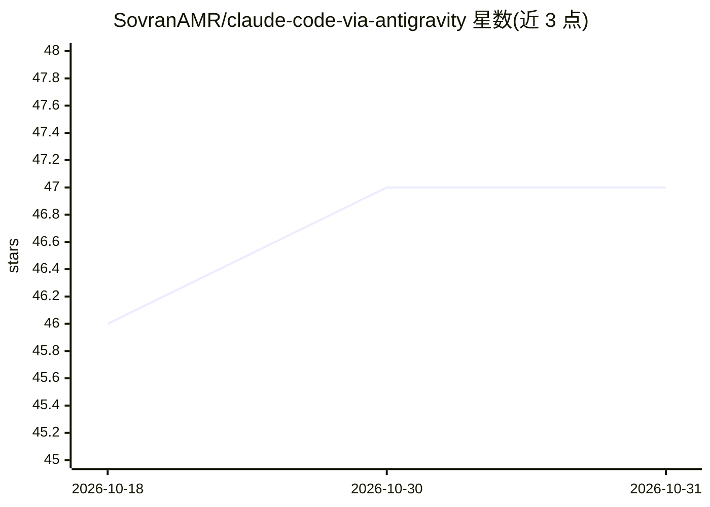

# SovranAMR/claude-code-via-antigravity

⭐ 47 · JavaScript · NOASSERTION · 推送 2026-02-13 · [GitHub](https://github.com/SovranAMR/claude-code-via-antigravity) · [官网](https://github.com/SovranAMR/claude-code-via-antigravity#quick-start) · 个人维护

**本地代理：用 Google 订阅免费驱动 Claude Code CLI**

轻量级本地代理（localhost:51200），拦截 Claude Code CLI 的请求，将 Anthropic Messages API 格式翻译为 Google Cloud Code Assist（Antigravity）API，使持有 Antigravity IDE Ultra 或 Google One AI Premium 订阅的用户无需 Anthropic API key 即可调用 Claude Opus 4.6 与 Sonnet 4.5。代理实现 OAuth 登录、令牌自动刷新、工具 schema 清洗、SSE 流格式转换与双端点并发。通过 git clone 源码运行，要求 Node.js 18+、Claude Code CLI 与相应 Google 订阅。

## 筛选速览

| 维度 | 判定 | 备注 |
|---|---|---|
| AI 角色 | `ai-ecosystem` | LLM/agent 周边工具 |
| 许可风险 | `none` | NOASSERTION |
| 部署形态 | `library` | 以包/库形式分发 |
| 模型依赖 | — | README 未给出锁定关系 |
| 硬件要求 | — | 无带数字的原话,不猜 |
| 安装摩擦 | `low` | 无编译、无系统依赖或容器化 |
| 成熟度 | — | 结构信号不足 |

## 能力要点

- Anthropic ↔ Google Code Assist 请求格式双向翻译
- Google OAuth 登录与令牌自动刷新
- 工具 schema 清洗与 SSE 流格式实时转换
- Linux/macOS/Windows 启动脚本支持

## 适用场景

- 用已有 Google 订阅运行 Claude Code CLI，无需另购 Anthropic API key
- 在本地把 Claude Code 请求转发到 Google 云端 Claude 模型

## 场景标签

`模型网关` · 领域:Agent 开发

## 证据(README 行号)

> L5: > A lightweight local proxy that bridges Claude Code CLI ↔ Google Cloud Code Assist API, giving you access to **Clau
> L18: The proxy intercepts Claude Code CLI requests, translates them from Anthropic's format to Google's Cloud Code Assis

## 星数曲线

2026-10-18 46 → 2026-10-31 47（+1）

---
*卡片 v1 · prompt 1.4 · 生成 2026-10-25 · 置信度 mid · 依据 README sha `5d9201f0671d` · [字段定义](../../DATASET.md)*
