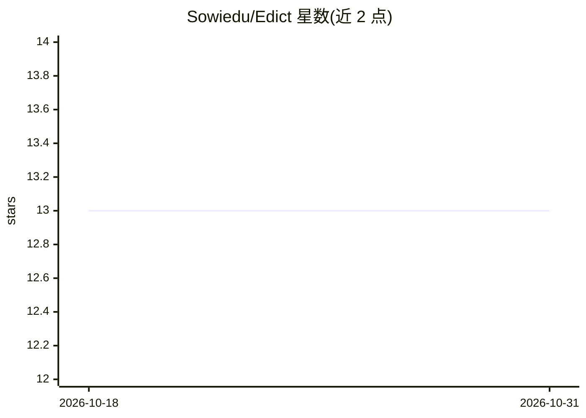

# Sowiedu/Edict

⭐ 13 · JavaScript · MIT · 推送 2026-10-25 · [GitHub](https://github.com/Sowiedu/Edict) · 个人维护

**面向 AI agent 的编程语言：agent 直接生成 JSON AST 并经 MCP 编译执行**

Edict 是一种静态类型、带效果追踪的编程语言，其程序格式为 JSON AST 而非文本代码，供 AI agent 通过 MCP 工具调用直接编写、验证与执行程序。编译管线含校验、类型检查、效果检查与基于 Z3 的契约验证（失败时返回具体反例），验证后编译为 WASM 在沙箱 VM 中运行，能力访问须经 EdictHostAdapter 显式授权。提供 23 个 MCP 工具、Docker 镜像、浏览器与 QuickJS 两种嵌入形态。

## 筛选速览

| 维度 | 判定 | 备注 |
|---|---|---|
| AI 角色 | `ai-ecosystem` | LLM/agent 周边工具 |
| 许可风险 | `permissive` | MIT |
| 部署形态 | `self-host` | docker 或自建部署 |
| 模型依赖 | — | README 未给出锁定关系 |
| 硬件要求 | — | 无带数字的原话,不猜 |
| 安装摩擦 | `low` | 无编译、无系统依赖或容器化 |
| 成熟度 | — | 结构信号不足 |

## 能力要点

- 无解析器：程序即 JSON AST，agent 经 MCP 工具调用直接提交
- 编译期用 Z3 验证前置/后置契约，失败返回具体反例
- 效果系统（pure/reads/writes/io/fails）编译期强制与运行时限额
- 编译到 WASM 沙箱执行，能力须经 host adapter 显式授予

## 适用场景

- 让 LLM agent 以结构化方式生成并自修复可验证程序
- 对 agent 生成代码做编译期类型/效果/契约检查后再沙箱执行
- 在浏览器或 QuickJS 等无文件系统环境内嵌编译器

## 场景标签

`代码生成` · 领域:编码与开发

## 证据(README 行号)

> L8: **A programming language designed for AI agents.** No parser. No syntax. Agents produce AST directly as JSON.
> L27: - **MCP interface** — All tools exposed via Model Context Protocol for direct agent integration.

## 星数曲线

2026-10-18 13 → 2026-10-31 13（+0）

---
*卡片 v1 · prompt 1.4 · 生成 2026-10-31 · 置信度 high · 依据 README sha `dcb5f187933b` · [字段定义](../../DATASET.md)*
