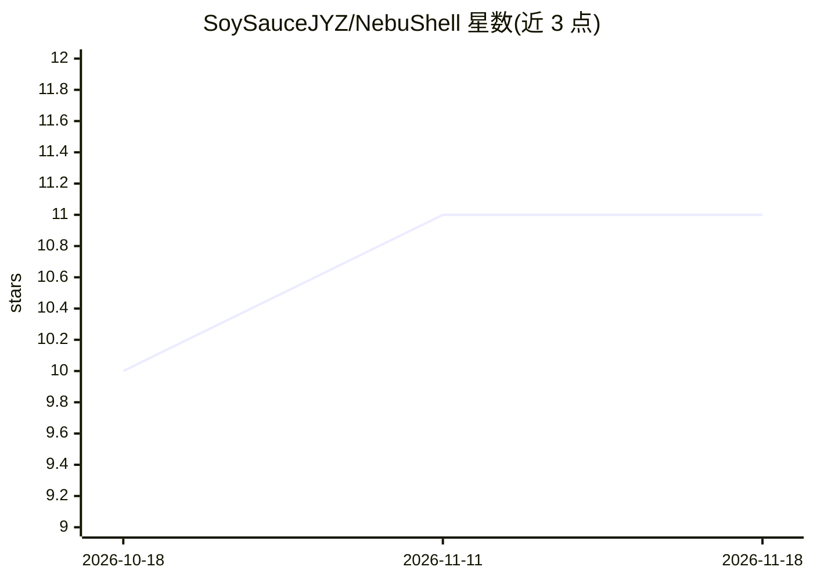

# SoySauceJYZ/NebuShell

⭐ 11 · TypeScript · MIT · 推送 2026-11-16 · [GitHub](https://github.com/SoySauceJYZ/NebuShell) · [官网](https://soysaucejyz.github.io/NebuShell/) · 个人维护 · 中文 README

**给 DevOps 的 AI Agent 驱动 SSH 客户端：终端+SFTP+加密保险库**

基于 Electron + React 的跨平台桌面 SSH 客户端，内置 OpenAI 兼容的运维 Agent：Agent 可执行 run_command、transfer_file、read_command_output 等工具，先提出计划、经用户确认后再在多终端及本机执行。功能涵盖多标签终端与递归分屏、SFTP 双栏文件管理、Monaco 远程编辑器、主密码加密保险库、Docker 容器管理、监控中心、代理管理与内置 MCP 服务器。所有数据本地存储，无需云账号；另提供面向无桌面 Linux 服务器的 Web 版（Docker 或 systemd 部署）。

## 筛选速览

| 维度 | 判定 | 备注 |
|---|---|---|
| AI 角色 | `ai-enhanced` | 去掉 AI 部分产品仍成立 |
| 许可风险 | `permissive` | MIT |
| 部署形态 | `desktop` | 安装包/桌面程序 |
| 模型依赖 | — | README 未给出锁定关系 |
| 硬件要求 | — | 无带数字的原话,不猜 |
| 安装摩擦 | `low` | 无编译、无系统依赖或容器化 |
| 成熟度 | — | 结构信号不足 |

## 能力要点

- OpenAI 兼容运维 Agent，支持计划-确认工作流后才执行命令
- 支持 MCP 服务器，Claude Code/Cursor 等 agent 可调用已保存主机
- SFTP 双栏管理、Monaco 编辑器直存远程文件
- Web 版可部署于无桌面 Linux 服务器，浏览器完整使用

## 适用场景

- SSH 管理多台服务器并用 AI 协助执行运维命令
- 双栏 SFTP 拖拽传输与远程文件在线编辑
- 集中管理 Docker 容器、镜像、卷与网络
- 局域网内通过 WebRTC 远程桌面控制 Windows 机器

## 场景标签

`AI 助手` · 领域:对话与助手

## 证据(README 行号)

> L12: **An AI‑agent‑powered SSH client / 由 AI 智能体驱动的运维终端**
> L39: - 🤖 **Built‑in AI ops agent** — an OpenAI‑compatible agent that can `run_command`, `transfer_file`, `read_command_o

## 星数曲线

2026-10-18 10 → 2026-11-18 11（+1）

---
*卡片 v1 · prompt 1.4 · 生成 2026-11-18 · 置信度 mid · 依据 README sha `24408dcd77ca` · [字段定义](../../DATASET.md)*
