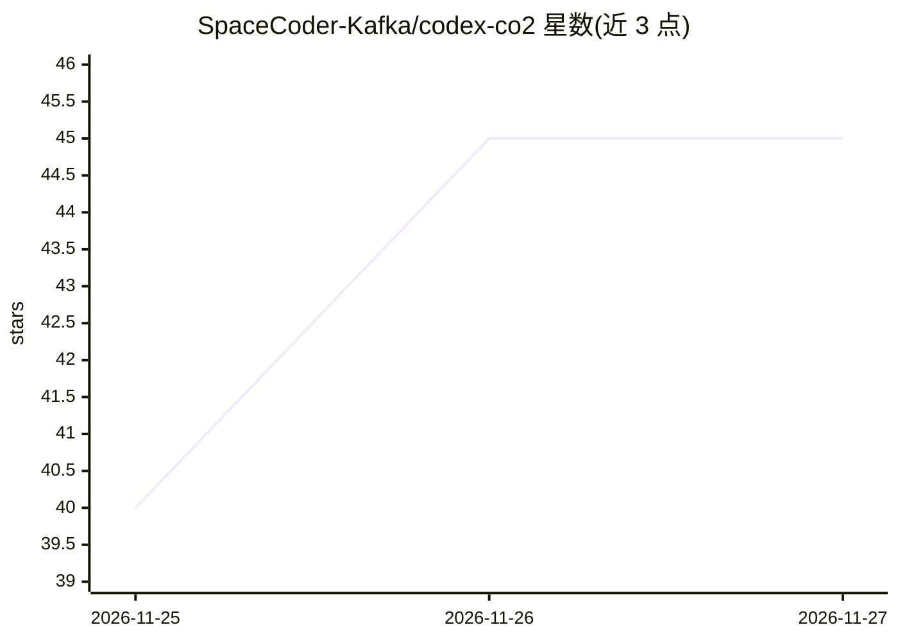

# SpaceCoder-Kafka/codex-co2

⭐ 45 · JavaScript · MIT · 推送 2026-11-24 · [GitHub](https://github.com/SpaceCoder-Kafka/codex-co2) · [官网](https://spacecoder-kafka.github.io/codex-co2/) · 组织维护 · 中文 README

**给 Codex Desktop 加多人协作：队友用浏览器共享同一条 AI 会话**

面向 macOS/Windows 的主机应用，接入已运行的官方 Codex Desktop（通过现有本地接口或桥接插件），把选中的单条会话经出站 TLS 中继或内网 HTTP 共享给团队成员；协作者用浏览器加入，无需安装、无需登录 Codex，可直接向同一个 Agent 发消息，消息沿用原会话的工具、沙箱与额度。支持逐条消息审批、随时撤销访问、以及「导入到我的 Codex」导出独立副本继续会话。仅共享选中会话，不共享其他会话与凭据，不提供端到端加密。安装包未经公证。

## 筛选速览

| 维度 | 判定 | 备注 |
|---|---|---|
| AI 角色 | `ai-enhanced` | 去掉 AI 部分产品仍成立 |
| 许可风险 | `permissive` | MIT |
| 部署形态 | `None` |  |
| 模型依赖 | — | README 未给出锁定关系 |
| 硬件要求 | — | 无带数字的原话,不猜 |
| 安装摩擦 | `low` | 无编译、无系统依赖或容器化 |
| 成熟度 | `idea` | |

## 能力要点

- 协作者浏览器直连同一 Agent，无需安装或登录 Codex
- 支持逐条消息审批、随时撤销访问，工具审批留在本地
- 「导入到我的 Codex」导出独立副本，交接不丢上下文
- 内网 HTTP 模式与公网 TLS 中继两种连接方式

## 适用场景

- 团队成员围绕同一个 Agent 结对编程、补充上下文
- 同事接手进行中的会话，在自己电脑上继续推进
- 评审者在浏览器中现场跟进回复与附件

## 场景标签

`编码 Agent` · 领域:编码与开发

## 证据(README 行号)

> L4:  团队成员用浏览器加入你正在进行的 Codex 会话，直接与同一个 AI 编程 Agent 对话。
> L65: Co² 接入你已经打开的 Codex Desktop，不会重启、修补或替换它；接口不兼容时直接停止接入。只共享你选中的那条会话，协作者的消息进入原会话，Agent 始终在你的电脑上运行。
> L81:  Codex Co²（Codex Conversation Collaboration）是独立实验项目，并非 OpenAI 官方产品，也未获 OpenAI 背书。项目代码使用 MIT 许可。随附组件的许可和项目素材的授权范围见许可

## 星数曲线

2026-11-25 40 → 2026-11-27 45（+5）

---
*卡片 v1 · prompt 1.4 · 生成 2026-11-24 · 置信度 mid · 依据 README sha `1d48f36aa6a3` · [字段定义](../../DATASET.md)*
