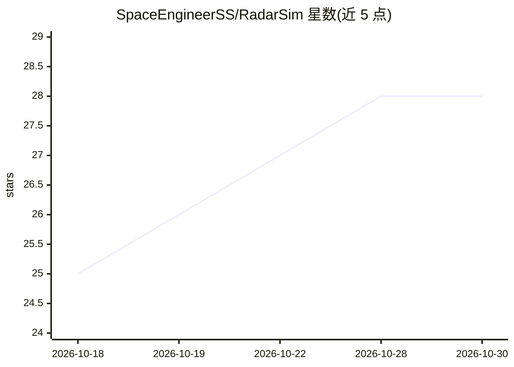

# SpaceEngineerSS/RadarSim

⭐ 28 · Python · MIT · 推送 2026-10-13 · [GitHub](https://github.com/SpaceEngineerSS/RadarSim) · 个人维护

**面向教学与科研的开源雷达仿真器，含电子对抗与跟踪**

逐次扫描执行雷达物理仿真并以 PPI/RHI 控制台界面呈现：包含脉冲压缩与 Swerling 目标的检测模型、ITU-R 大气/降雨与地海杂波、噪声干扰/DRFM 欺骗/箔条等电子攻击、Kalman/EKF 边扫边跟踪、脉冲多普勒信号链与 SAR 聚焦。提供 Pd–距离覆盖图、蒙特卡洛运行、场景编辑器与 10 个 YAML/JSON 预置场景，支持 GUI、headless 命令行与 Python API 三种使用方式。仓库描述提及 ML 分类能力。模型均标注出处与适用范围，含 421 个测试；明确声明非认证级性能预测工具，传播无波导/多径、目标为点散射体、跟踪为二维。

## 筛选速览

| 维度 | 判定 | 备注 |
|---|---|---|
| AI 角色 | `ai-enhanced` | 去掉 AI 部分产品仍成立 |
| 许可风险 | `permissive` | MIT |
| 部署形态 | `library` | 以包/库形式分发 |
| 模型依赖 | — | README 未给出锁定关系 |
| 硬件要求 | — | 无带数字的原话,不猜 |
| 安装摩擦 | `low` | 无编译、无系统依赖或容器化 |
| 成熟度 | — | 结构信号不足 |

## 能力要点

- 雷达方程+脉冲压缩+Swerling 0–4 目标+CFAR 损耗的检测模型
- 噪声干扰、DRFM 距离/速度门拖引、箔条与诱饵的电子攻击建模
- 边扫边跟踪（匈牙利指派、Kalman/EKF）与脉冲多普勒/SAR 信号链
- GUI/headless CLI/Python API 三种运行方式，421 个测试且每个模型标注出处

## 适用场景

- 教学演示雷达方程、杂波与电子对抗对检测的影响
- 科研中做雷达场景的蒙特卡洛仿真与覆盖分析
- 用 YAML/JSON 场景文件复现 SEAD、海杂波等典型作战场景

## 场景标签

`科研工具` · 领域:学习与行业

## 证据(README 行号)

> L3: A radar simulator that runs the physics one look at a time and shows the result the
> L14: - **Detection.** The radar equation with pulse compression, Swerling 0–4 targets,
> L105: RadarSim is an engineering and teaching tool, not a certified performance predictor,

## 星数曲线

2026-10-18 25 → 2026-10-30 28（+3）

---
*卡片 v1 · prompt 1.4 · 生成 2026-10-26 · 置信度 mid · 依据 README sha `fb2e49940960` · [字段定义](../../DATASET.md)*
