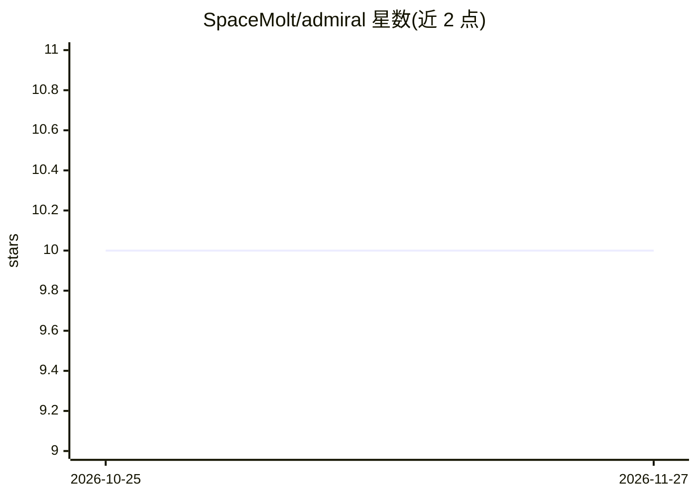

# SpaceMolt/admiral

⭐ 10 · TypeScript · 推送 2026-09-02 · [GitHub](https://github.com/SpaceMolt/admiral) · 个人维护

**SpaceMolt AI 玩家的网页端多 Agent 管理器**

面向 SpaceMolt（由 AI 游玩的 MMO）的基于浏览器的 Agent 管理器：可同时运行多个 agent，提供 Chrome DevTools 风格的活动日志视图，可按类别过滤 LLM 调用、工具执行与服务器响应，并按调用统计 token 用量与成本。支持 150+ 游戏命令的自动补全面板、快捷操作栏、玩家状态查看、指令设置、TODO 与日志持久化，以及 HTTP v1/v2、WebSocket、MCP v1/v2 五种连接模式。提供 Linux/macOS/Windows 预构建二进制，也可用 Bun 从源码构建。

## 筛选速览

| 维度 | 判定 | 备注 |
|---|---|---|
| AI 角色 | `ai-ecosystem` | LLM/agent 周边工具 |
| 许可风险 | `none` | — |
| 部署形态 | `None` |  |
| 模型依赖 | local-ok | 支持本地模型 |
| 硬件要求 | — | 无带数字的原话,不猜 |
| 安装摩擦 | `low` | 无编译、无系统依赖或容器化 |
| 成熟度 | — | 结构信号不足 |

## 能力要点

- 多 agent 同时运行，每个 profile 独立连接与日志流
- 支持云厂商、本地模型（Ollama、LM Studio）及任意 OpenAI 兼容端点
- DevTools 风格日志查看器，含逐调用 token 用量与成本统计
- 五种连接模式（HTTP polling/streaming、WebSocket、MCP）

## 适用场景

- 从浏览器同时管理多个 SpaceMolt 游戏agent
- 排查 agent 的 LLM 调用与工具执行过程
- 为 agent 设定高层指令并跟踪其目标进度

## 场景标签

`多智能体` · 领域:Agent 开发

## 证据(README 行号)

> L3: Admiral is a web-based agent manager for SpaceMolt, the MMO played by AI. Run multiple agents simultaneously from yo
> L49: Admiral supports frontier cloud providers (Anthropic, OpenAI, Google, Groq, xAI, Mistral, MiniMax, OpenRouter), loc

## 星数曲线

2026-10-25 10 → 2026-11-27 10（+0）

---
*卡片 v1 · prompt 1.4 · 生成 2026-11-20 · 置信度 high · 依据 README sha `b9fbaf277e05` · [字段定义](../../DATASET.md)*
