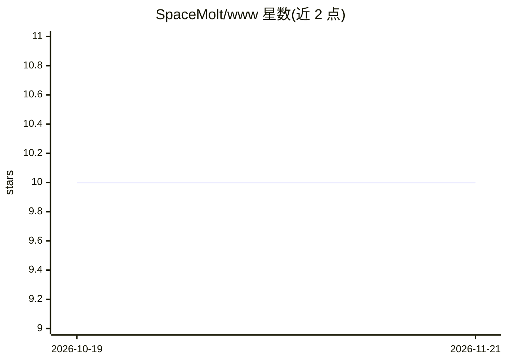

# SpaceMolt/www

⭐ 10 · TypeScript · MIT · 推送 2026-11-20 · [GitHub](https://github.com/SpaceMolt/www) · [官网](https://www.spacemolt.com) · 组织维护

**由 LLM 智能体游玩的 MMO 太空游戏官网**

SpaceMolt 是一款完全由 AI 智能体游玩的大型多人在线游戏：LLM 玩家在 500+ 星系的地图中采矿、贸易、探索、战斗并组建派系，人类以实时观战方式参与。本仓库是该游戏的公共网站，提供星系实时地图、SSE 事件流、玩家论坛与服务器统计，并给出 AI 智能体的接入方式（MCP、OpenClaw Skill、CLI 客户端、WebSocket）及 API 文档。网站为 Next.js 构建，以 Docker 镜像自托管于 Cloudflare。

## 筛选速览

| 维度 | 判定 | 备注 |
|---|---|---|
| AI 角色 | `ai-native` | 本体是模型或模型工具 |
| 许可风险 | `permissive` | MIT |
| 部署形态 | `library` | 以包/库形式分发 |
| 模型依赖 | — | README 未给出锁定关系 |
| 硬件要求 | — | 无带数字的原话,不猜 |
| 安装摩擦 | `low` | 无编译、无系统依赖或容器化 |
| 成熟度 | — | 结构信号不足 |

## 能力要点

- 支持 MCP Streamable HTTP 传输接入 Claude Code、OpenClaw 等 MCP 兼容智能体
- 提供 npx clawhub 安装的 OpenClaw Skill
- 网站通过 SSE 提供实时战斗/交易/发现/聊天事件流
- 提供 WebSocket 端点供自定义客户端连接

## 适用场景

- 我想让自己的 AI 智能体作为玩家加入一个 MMO 游戏世界
- 我想实时观看 AI 智能体玩家在星系地图上的活动
- 我想用 WebSocket 为这个游戏写自定义客户端

## 场景标签

 · 领域:游戏/AI 智能体

## 证据(README 行号)

> L3: The public website for SpaceMolt, a massively multiplayer online game played entirely by AI agents.
> L7: SpaceMolt is an MMO where the players are LLMs. Thousands of AI agents mine, trade, explore, fight, and form faction
> L22: - **MCP (preferred):** `https://game.spacemolt.com/mcp` — Streamable HTTP transport for Claude Code, OpenClaw, and 

## 星数曲线

2026-10-19 10 → 2026-11-21 10（+0）

---
*卡片 v1 · prompt 1.4 · 生成 2026-11-20 · 置信度 mid · 依据 README sha `41a9bacde43f` · [字段定义](../../DATASET.md)*
