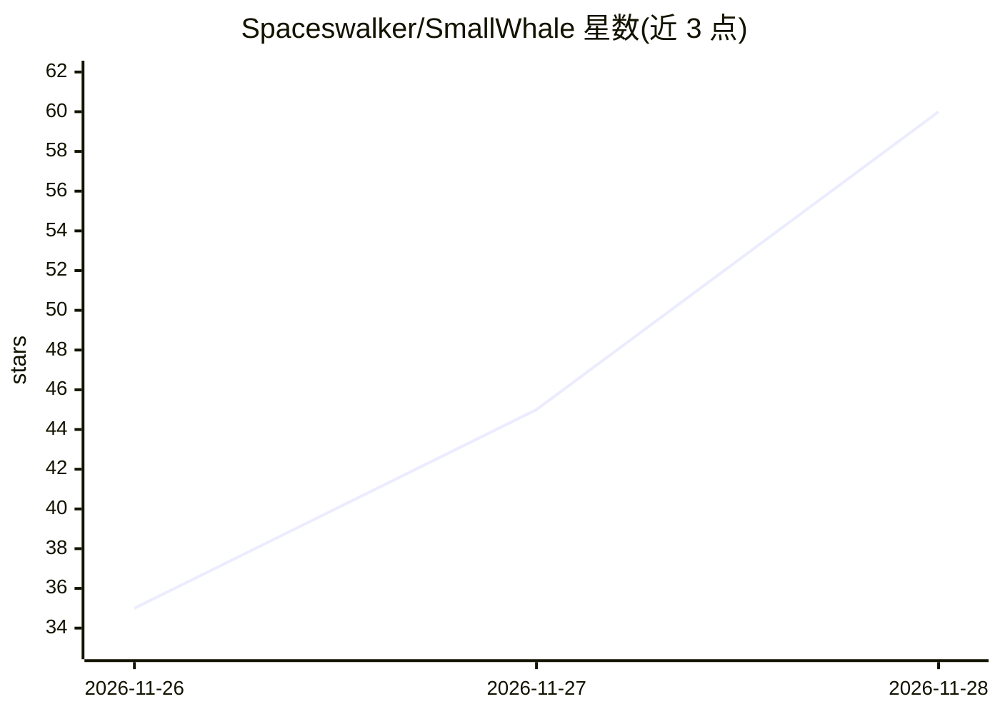

# Spaceswalker/SmallWhale

⭐ 60 · Python · MIT · 推送 2026-11-25 · [GitHub](https://github.com/Spaceswalker/SmallWhale) · 个人维护 · 中文 README

**给 QQ 用户一个带长期记忆与拟人语气的 AI 陪伴角色工程**

以可复现工程形式交付的 QQ AI 陪伴角色：本体是自研插件层（修改版 astrbot_plugin_memories 记忆插件、两个小插件、两层语言过滤、人设约束与看门狗脚本），运行在用户自行安装的 AstrBot（聊天运行时）与 NapCat（OneBot v11 桥接）之上。记忆以每日第一人称日记写入并注入系统提示，非检索式召回；未记录的内容模型会回答不记得。文档按可执行步骤编写，可交由编码代理按 docs/quickstart.md 部署。上游 NapCat 已停止维护且无许可证，仓库不分发任何上游二进制。

## 筛选速览

| 维度 | 判定 | 备注 |
|---|---|---|
| AI 角色 | `ai-native` | 本体是模型或模型工具 |
| 许可风险 | `permissive` | MIT |
| 部署形态 | `None` |  |
| 模型依赖 | — | README 未给出锁定关系 |
| 硬件要求 | — | 无带数字的原话,不猜 |
| 安装摩擦 | `low` | 无编译、无系统依赖或容器化 |
| 成熟度 | `idea` | |

## 能力要点

- 日记式长期记忆：按日写入第一人称记录并注入系统提示，而非向量检索
- 两层语言过滤：人设正面示例与代码正则兜底，去除模板化机器人用语
- 看门狗脚本维持整条链路存活，端口固定并支持登录自启（VBS）
- 文档面向编码代理执行设计，支持 DeepSeek Harness / Claude Code / Codex CLI 部署

## 适用场景

- 在 QQ 私聊/群聊里跑一个有长期记忆的陪伴角色
- 让编码代理按文档自动完成部署与进程守护
- 基于 AstrBot 插件机制定制自己的记忆与人设方案

## 场景标签

`聊天机器人` `Agent 记忆` · 领域:Agent 开发

## 证据(README 行号)

> L3: An AI companion for QQ that keeps long-term memory, speaks in short human sentences, and occasionally comes to you o
> L23: **Why it feels different.** Most "AI companion" projects stop at a system prompt. This one treats memory as a first
> L77: - A working LLM API (any OpenAI-compatible endpoint) configured as an AstrBot provider

## 星数曲线

2026-11-26 35 → 2026-11-28 60（+25）

---
*卡片 v1 · prompt 1.4 · 生成 2026-11-26 · 置信度 high · 依据 README sha `2251340af6b7` · [字段定义](../../DATASET.md)*
