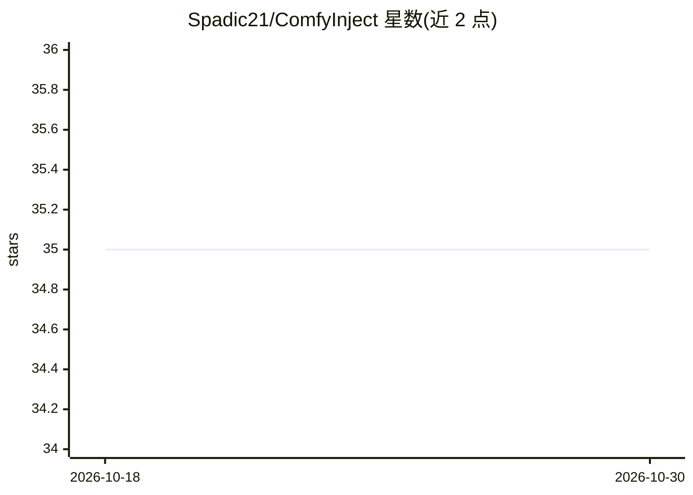

# Spadic21/ComfyInject

⭐ 35 · JavaScript · AGPL-3.0 · 推送 2026-03-20 · [GitHub](https://github.com/Spadic21/ComfyInject) · 个人维护

**SillyTavern 扩展：把聊天中 [[IMG:]] 标记自动经本地 ComfyUI 生成图片**

面向 SillyTavern 用户的第三方扩展：拦截 LLM 回复中的 [[IMG: PROMPT | AR | SHOT | SEED]] 标记，将提示词发送到用户本地运行的 ComfyUI 实例，生成图片并内嵌替换到聊天中。支持单条消息多图、图片永久存入聊天历史、出站提示词以紧凑 token 替代图片以维持视觉连续性。提供宽松的标记解析与自动修复、内置图片画廊（含 seed/prompt/修复详情）、重试按钮、自定义工作流与采样参数配置。要求 SillyTavern 与本地 ComfyUI，并需在 ComfyUI 侧开启 CORS。

## 筛选速览

| 维度 | 判定 | 备注 |
|---|---|---|
| AI 角色 | `ai-ecosystem` | LLM/agent 周边工具 |
| 许可风险 | `viral` | AGPL-3.0 |
| 部署形态 | `desktop` | 安装包/桌面程序 |
| 模型依赖 | — | README 未给出锁定关系 |
| 硬件要求 | — | 无带数字的原话,不猜 |
| 安装摩擦 | `low` | 无编译、无系统依赖或容器化 |
| 成熟度 | — | 结构信号不足 |

## 能力要点

- 拦截 [[IMG:]] 标记并调用本地 ComfyUI 生成图片，替换进聊天
- 标记宽松解析与自动修复（缺省字段、乱序、重复 token 处理）
- 内置图片画廊展示 seed/prompt/AR/Shot 与修复详情
- 出站提示词以紧凑 token 替代图片，维持对话视觉连续性

## 适用场景

- 角色扮演聊天中让 AI 回复自动配图
- 通过自定义工作流和采样参数控制生图效果
- 在画廊中排查标记解析与生成参数问题

## 场景标签

`图像生成` `聊天机器人` · 领域:对话与助手

## 证据(README 行号)

> L3: A SillyTavern extension that automatically generates images from `[[IMG: ... ]]` markers in bot messages using your 
> L5: When your LLM outputs a marker, ComfyInject intercepts it, sends the prompt to ComfyUI, and replaces the marker with

## 星数曲线

2026-10-18 35 → 2026-10-30 35（+0）

---
*卡片 v1 · prompt 1.4 · 生成 2026-10-25 · 置信度 high · 依据 README sha `2f9b4e6003d9` · [字段定义](../../DATASET.md)*
