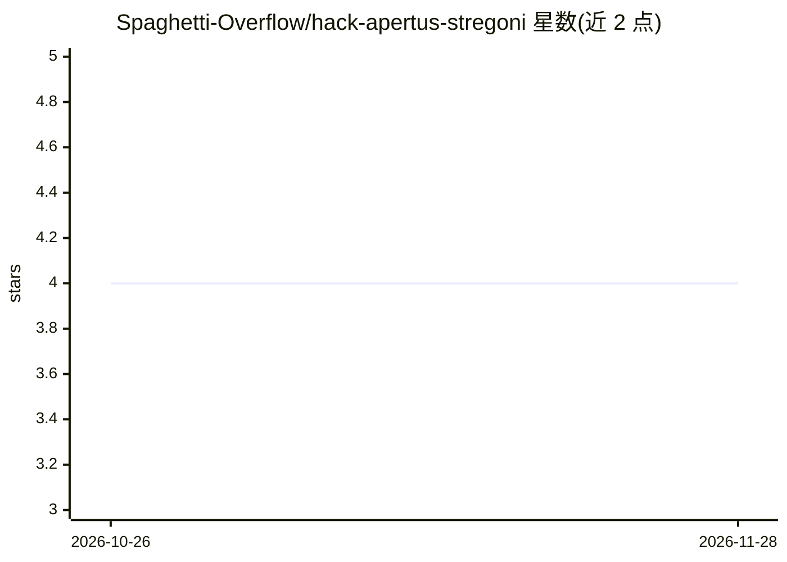

# Spaghetti-Overflow/hack-apertus-stregoni

⭐ 4 · Python · Apache-2.0 · 推送 2026-10-20 · [GitHub](https://github.com/Spaghetti-Overflow/hack-apertus-stregoni) · [官网](https://hackapertus.ch/regions/bern-liebefeld) · 组织维护

**为伯尔尼经济发展署匹配研究资源的 RAG 检索工具**

为 Hack Apertus 黑客松伯尔尼经济发展署挑战构建的应用：用日常语言描述公司研究需求，系统经 Apertus 模型解析意图，在 UniBE、ARTORG 与糖尿病中心伯尔尼的生态内做 PostgreSQL 全文与 pgvector 混合检索（RRF 融合、可选重排序），输出带原文段落与 URL 引用的证据包，经人工保留/驳回审阅后导出 PDF 或 PowerPoint 简报。提供 mock 模式的无凭据演示路径与 make 管理的完整连接环境。

## 筛选速览

| 维度 | 判定 | 备注 |
|---|---|---|
| AI 角色 | `ai-native` | 本体是模型或模型工具 |
| 许可风险 | `permissive` | Apache-2.0 |
| 部署形态 | `None` |  |
| 模型依赖 | — | README 未给出锁定关系 |
| 硬件要求 | — | 无带数字的原话,不猜 |
| 安装摩擦 | `low` | 无编译、无系统依赖或容器化 |
| 成熟度 | — | 结构信号不足 |

## 能力要点

- Apertus v1.5 将日常表述映射到领域词表，保留需求与约束
- PostgreSQL 全文与 pgvector 混合检索、RRF 融合、可选重排序
- 引用精确段落、原始 URL、来源状态与缺失信息，供人工审阅
- 保留/驳回审阅与精确哈希审批后确定性导出 PDF/PPT

## 适用场景

- 为公司研究需求查找伯尔尼本地研究团队与基础设施
- 审阅带来源引用的调研结论并导出简报
-  Hackathon 评委无凭据浏览 mock 演示流程

## 场景标签

`RAG` `语义搜索` · 领域:知识与检索

## 证据(README 行号)

> L7: B2Bern helps economic-development staff discover relevant people, research groups, projects and infrastructure acros
> L23: - **Searches one ecosystem:** independent PostgreSQL full-text and pgvector retrieval, RRF fusion, optional reranki

## 星数曲线

2026-10-26 4 → 2026-11-28 4（+0）

---
*卡片 v1 · prompt 1.4 · 生成 2026-11-21 · 置信度 high · 依据 README sha `2deb1f584059` · [字段定义](../../DATASET.md)*
